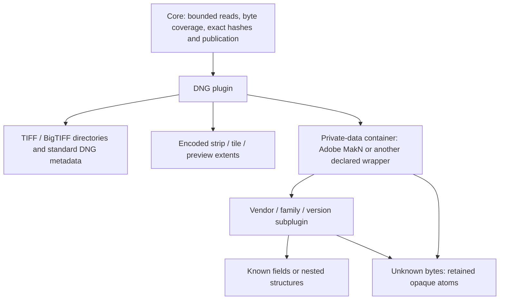

# Gradual camera understanding and nested DNG plugins

Status (2026-10-19): the architecture is specified in [SOL.md](../SOL.md),
and its component/refinement/checkpoint kernel, frozen DNG child dispatch,
layout-only exact-transfer profile, and optional exiftool-rs knowledge bridge
are implemented. They have different qualification scopes; none grants general
relocation, camera equivalence or rendering authority. Photo consultation is
historical, not an outstanding design-approval gate.

The latest [actual stock/Ox component controls](../tests/qualification/current-component-refinement-actual-20261019.json)
renew private-view replacement, nested refinement, unchanged encoded-pixel reuse,
checkpoint authentication and input revalidation. Actual camera/container and
receiving coverage remains scoped by the final acceptance checklist. Unknown
small fields do not prevent deployment of independently qualified exact paths.

The user explicitly confirmed that separate pixel/metadata hashing is a large
enough win to deploy without waiting for complete mapping of smaller fields.
Unknown fields stay preserved and hash-covered. As their meaning/stability is
learned, nested plugins refine only affected hash components and dependent
roots; already verified pixel components are reused with valid input bindings.
This is not a requirement to reverse-engineer every field before shipping.
The detailed cache invalidation, versioning and lazy rehash contract is normative
in SOL.md; this document develops the plugin and operation boundaries.

## Aim

Understand the standard container and pixel layout first. Preserve unrecognized
data exactly. Add vendor/model/version interpretations incrementally, without
requiring a complete explanation of every camera byte before useful operations
are possible. Community contributions and our own small discoveries should use
the same bounded extension mechanism.

"Understanding" is a set of independently evidenced claims, not one Boolean or
an ascending camera score. Knowing a field's name does not prove its pointer
rules. Locating compressed pixels does not prove decoded-pixel equivalence.
Successful SDK validation does not prove that private metadata is independent
of an editable packet.

## What a plugin reports

Each immutable, versioned plugin contributes a bounded fragment of a shared
file model:

- **Identity evidence:** exact supported signature, wrapper, byte order,
  maker/model constraints, version and how each was observed. Filename or model
  text alone is a hint, not an authoritative dispatch rule.
- **Physical extents:** file-relative ranges, their derivation and owners.
  Every byte remains covered by exact hashing. Unclaimed bytes become opaque
  atoms rather than disappearing from the model.
- **Interpretation:** standard tag or private field identity, encoded pixel
  range, descriptive value, rendering input, identity/workflow value, or unknown.
  A semantic view may overlay physical extents; it does not create another copy
  or grant another writer ownership.
- **References:** source field, width/order, address-space/base, target extent,
  and evidence for the rule. Report an unknown dependency explicitly when no
  rule is known. Scalar-shaped fields and UNDEFINED blobs are not presumed
  pointer-free.
- **Preservation constraints:** opaque bytes' digest, length and placement;
  declared relocation limits; known checksums/length fields and their coverage.
- **Evidence and provenance:** parser/schema version, supporting specification
  or implementation, fixture identities, observed sample scope and unsupported
  variants. Validation reports remain separate observations.

The parent validates containment, overflow, total work/read/memory budgets,
reference bounds and incompatible claims. Children borrow restricted readers
and shared budgets; nesting must not multiply the parent's limits. Recursion,
directory count and graph cycles have explicit bounds. No child obtains a
write handle, registry mutation, subprocess permission or larger address space
merely by recognizing a structure.

Physical atoms form an exact canonical partition. Semantic views may overlap
that partition where the format permits aliasing, with explicit provenance.
Conflicting structural claims are retained as ambiguity/refusal, not resolved
by plugin registration order. A more specific child can refine an opaque atom;
it cannot silently discard its parent's byte-preservation obligation.

## Permission follows the operation, not the amount decoded

| Operation | Required evidence | What remains unknown |
|---|---|---|
| Ordinary exact transfer | Existing complete-file integrity and ownership checks | All format meaning may remain unknown |
| Inspect standard metadata / encoded pixel extents | Bounded container/layout evidence | Private fields and decoded rendering may remain unknown |
| Same-layout, byte-exact accelerated receiving | Bound basis and actual donor; equal size/layout and complement hash; independent complete staged-file hash equal to donor | Hidden private references need not be interpreted |
| Advisory metadata classification | Explicit field/category interpretation, unknown categories retained | No authority to suppress a conflict or alter a file |
| Stable semantic identity or ignoring a difference | Defined projection, all excluded domains/dependencies justified, unknown atoms included conservatively | Unresolved dependencies prevent that particular projection |
| Relocation / structural rewriting | Complete reference and checksum rules for the moved/affected domain, including inbound references | Unrelated opaque domains can remain unknown only if their noninterference is established |
| Synthesized three-way metadata merge | Trusted common base, exact scoped merge policy and dependency conditions | Byte-exact donor transfer alone does not justify synthesized content |

The byte-exact row is particularly useful now. An unknown private reference may
alias an XMP byte, or a private checksum may depend on XMP. If the reconstructed
file is nevertheless **identical to the actual selected donor**, the transfer
has not changed those relationships relative to an ordinary whole-file copy.
Unknown private bytes remain part of the complement and complete-file hashes.
If they changed, or span/layout assumptions are wrong, the fast plan refuses
or the final hash fails; the private stage must never be published as success.
Source validity is a separate matter, just as with ordinary transfer; optional
SDK policy applies independently.

This is not permission to declare files semantically equivalent because their
known pixel/metadata fields match. Unknown atoms must continue to distinguish
them. It is also not a way to synthesize a "good" target and authenticate it
using a hash computed from that same unvalidated synthesis.

## Mapping to current Unison

[FormatExtension](../src/formatExtension.mli) remains the exact-transfer
contract: bounded spans and optional advisory observations. Nested byte-role
knowledge lives separately in [ComponentHash](../src/componentHash.mli) and
[DngComponents](../src/dngComponents.mli), not in a widened transfer authority.
The owner freezes trusted compiled decoder handles; workers receive immutable
selection and scoped readers. This is not a native-code sandbox.

[SemanticDelta](../src/semanticDelta.ml) binds the profile, size, regions,
protected complement and complete target digest. The implemented
`org.firstpair.dng-layout/0` profile uses `Opaque_spans`, so its classification
is `Uninterpreted_regions`, not `Editable_metadata`. Exact reconstruction of the
selected donor remains safe without interpreting hidden references, provided
all independent basis/stage/target verification succeeds. Strict XMP profiles
`org.firstpair.dng-xmp/0` and `/1` retain their separate eligibility rules;
layout-only support does not gain their synthesized reconciliation authority.

`ComponentHash.apply_plugin` refines one parent domain with a shared bounded
reader. `DngComponents.freeze_decoders` supplies ordered, locally trusted
bindings, allowing plugins inside plugin-exposed children without a global
mutable registry per nested level. Unknown gaps stay opaque. Replacing a
private decoder resets only that private view, rechecks its bytes and recomputes
dependent views; unaffected encoded-pixel nodes can be reused within the valid
session. Checkpoint restoration still authenticates owner-held metadata and
revalidates the complete current input before incremental refinement.

The optional [exiftool-rs bridge](../tools/exiftool-bridge/README.md) contributes
a nested vendor/field knowledge view. Its current Tag API does not export source
byte spans, so decoded fields cannot be promoted into physical ownership,
relocation rules or permission to ignore differences. Engine/schema provenance
stays separate from exact byte hashes. More decoded names are useful knowledge,
not a blanket semantic-equivalence certificate.

## Community extension contract

Start with compiled, locally trusted modules or a deliberately restricted data
schema—not arbitrary peer-delivered code. IDs include namespace and version;
pin implementation/schema and test vectors. No network downloads or runtime
installation occur during synchronization. A parser contract is not a native
code sandbox; untrusted native community code requires a separately designed
isolation boundary before use.

Adding interpretation alone must not silently change archive identities or
the wire hash. A changed semantic projection/transform requires a new profile
and peer capability. A peer without a child decoder can still preserve that
domain as opaque and use the agreed exact-byte operation. Both sides must agree
on the exact operation/profile and any required child contract; optional local
advisory knowledge need not force installing identical decoder collections.

Every contribution needs original bounded fixtures: recognized and unsupported
versions, malformed counts/offsets, aliases, hidden-reference counterexamples,
unknown-tag preservation, deterministic failure, cancellation and ownership
controls. Camera samples add scoped evidence, not universal camera support.

## Historical first implementation sequence

The steps below preserve the original sequencing proposal; use the current
implementation/evidence links above for status, not this historical list as a
new approval or deployment gate.

1. Record Photo Root's feedback on shared interfaces and the operation/evidence
   split; consultation does not postpone the user's approved partial-coverage baseline.
2. Define the typed knowledge fragment, restricted reader and shared budget,
   plus capability checks and deterministic parent composition. Keep current
   public profiles unchanged.
3. Add an explicitly named layout-only DNG exact-transfer successor. Reuse the
   standard bounded locator, preserve all unknown/private bytes, require donor
   full-hash verification, and deny semantic merge/ignore/relocation authority.
   Original fixtures should deliberately include hidden references into the
   changed span and show that exact reconstruction succeeds without claiming
   semantic independence; bad final hashes must fail publication.
4. Emit standard metadata and encoded-pixel delineation as separate claims.
   Progressively refine Adobe MakN and vendor subdomains with bounded children.
5. Qualify a retained-camera disposable-clone case under a new exact admission;
   no existing consumed grant covers it. Expand community coverage incrementally.

The just-completed nine-byte observation returned `X2D 100C`. Hasselblad's
[official product listing](https://store-na.hasselblad.com/fr/products/x2d-100c)
uses that model name. This supports a Hasselblad-family investigation; it is
not a self-authenticating vendor/header discriminator or a private grammar.
The other candidate text fields remain unread. Most of the private payload is
still opaque, which this architecture is intended to accommodate explicitly.
