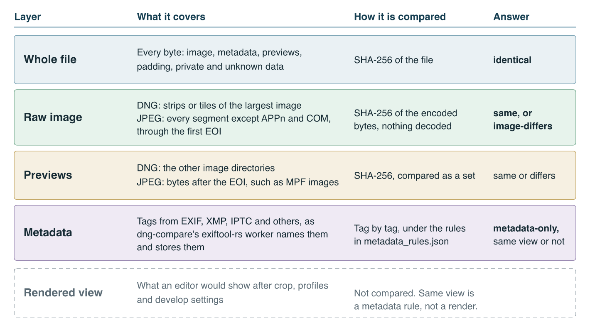
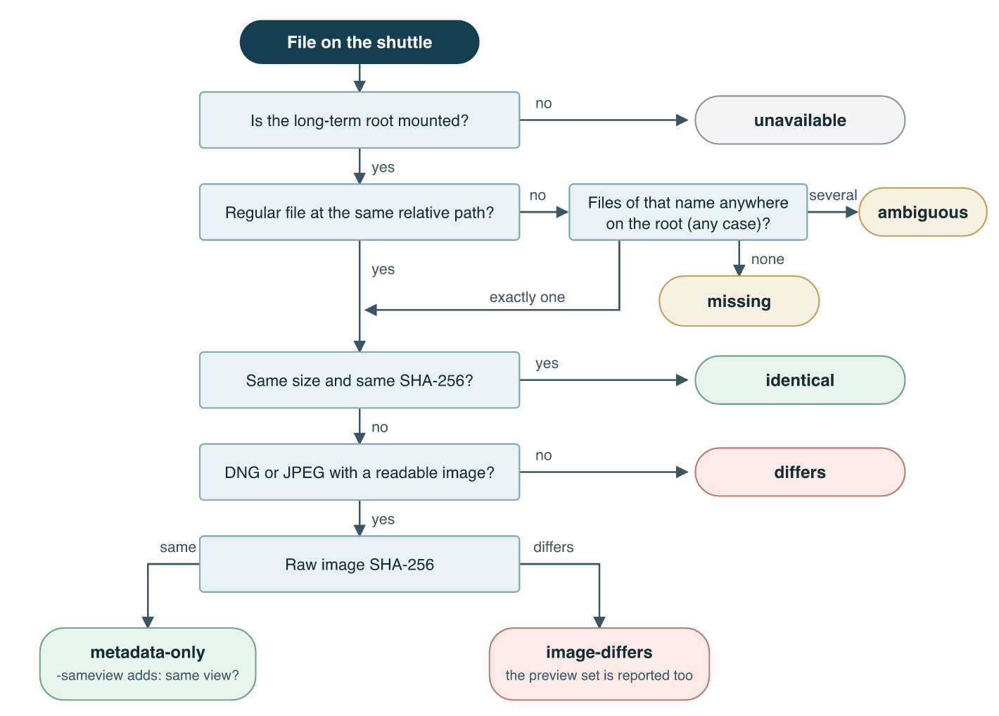
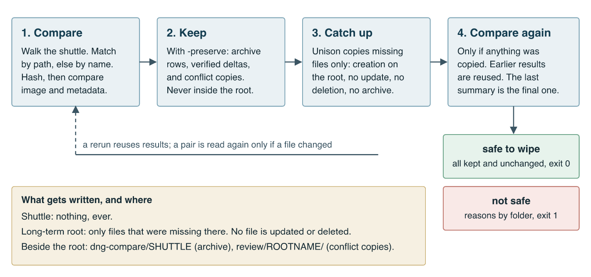
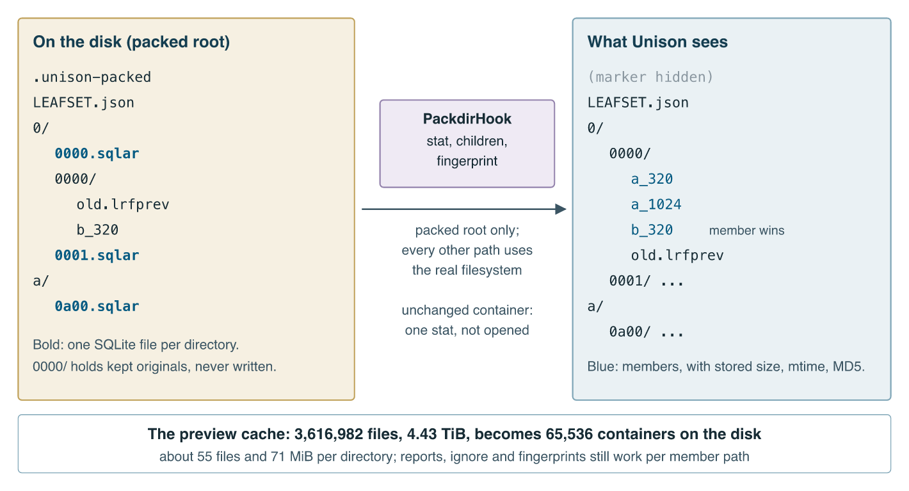
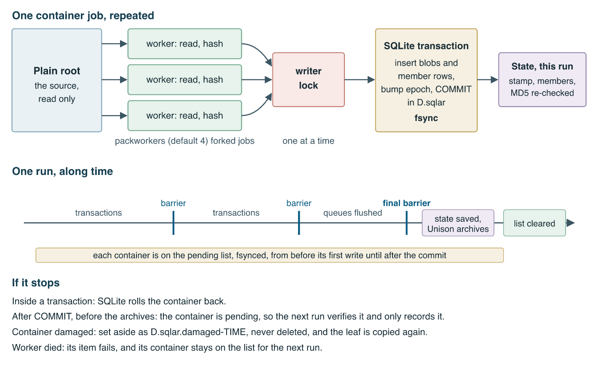

# Semantic Unison: a fork that knows what changed in a photograph


This post is by Alexy Khrabrov, with Claude as co-author. The ideas are Alexy's; Claude wrote the text and much of the code with him. That collaboration is the reason the project exists in the form it does, so it comes first.

[Unison](https://github.com/bcpierce00/unison) is a file synchronizer with more than 25 years of use behind it. It keeps two replicas of a tree in step, working out what changed on each side since they last agreed. [Semantic Unison](https://github.com/querygraph/semantic-unison) is a public fork that teaches it three new things: what is inside a photograph file, how to prove a shuttle disk is safely kept before wiping it, and how to store millions of small files on one spinning disk without paying for each of them on every run.

This is a tour of all three, with the measured numbers, including the ones that embarrassed the estimates. A full book, *Semantic Unison*, covers every option. It is in the [First Pair library](https://firstpair.org/books/semantic-unison/), with [PDF](https://firstpair.org/semantic-unison/pdf/) and [EPUB](https://firstpair.org/semantic-unison/epub/) editions, and its second edition adds the mirror's results and clones.

## Why a fork

Unison's `CONTRIBUTING.md` is direct:

> LLMs essentially always use training input without copyright permission, and the unison maintainer considers the output from LLMs to be a derived work of the training data. Thus *LLM-generated code is simply not acceptable for submission to the project*.

It goes on: "It is ethically unacceptable to ask humans to review and deal with code generated by LLMs," and "LLM-generated text is not allowed in issues, in PRs, in the wiki, on mailinglists, or any other part of the project." The same file says the project has no paid contributors and about 0.1 FTE across two people.

That is the maintainers' call, and it deserves to be taken at face value. A synchronizer holds files people cannot replace. The trust in it was earned over decades, and the people who keep it have every right to decide how their time is spent. Upstream owes this work neither review nor endorsement, and it has received no request for either. Nothing from the fork goes to upstream's issues, pull requests, mailing lists or wiki, and this post is no exception.

The fork exists because the GPL allows it and a person wanted these features enough to take responsibility for them. The burden does not disappear. It moves to that person, who decides what to build, approves anything touching real disks, runs the checks only a human can run, and tracks upstream alone. In place of human review upstream, the fork offers public history, visible attribution, and qualification evidence: named test matrices on stock OCaml and OxCaml, results bound to source and binary hashes, and failures kept beside the successes.

One of the sessions wrote an essay about this, [I am an honest working LLM](https://github.com/querygraph/semantic-unison/blob/master/I-AM-AN-HONEST-WORKING-LLM.md). It accepts the refusal and disputes the blanket ethical judgment, and asks that the fork "be judged by its code, its evidence, its usefulness, and the maintenance it actually receives."

## What plain Unison cannot see

To Unison, a file is a path with a fingerprint. If one byte differs, the file differs. That is the right default, and the fork keeps exact bytes as its contract. But a DNG raw file is mostly image data that never changes. A new rating in Lightroom rewrites a small piece of XMP inside a large file. Plain Unison sees a changed file, and if both sides changed, a conflict.

The fork adds versioned format profiles. A profile finds the editable bytes, such as one XMP packet, and the core proves everything else identical with strong hashes. With `semanticdng = true`, a one-sided metadata edit moves only the changed bytes. On APFS, the receiver clones its own copy privately, patches the clone, verifies the entire result against the source's full SHA-256, and publishes it through Unison's normal rename. When the packet has grown or moved, or the file holds something the profile doesn't recognize, the profile declines and Unison copies the file normally.

An opt-in merge goes further. With `merge = Name *.dng -> unison:dng-xmp-scalars/0`, a rating on one machine and a colour label on another become one exact file, sent to both sides. Anything else, such as competing values, a changed image, or a grown packet, stays an ordinary conflict. JPEG gets a transfer profile too. The rule throughout is that semantic identity explains a change and never replaces byte identity, because XMP can hold develop settings, so "only the XMP changed" does not mean "the photograph looks the same."

## Semantic diff: is this disk safe to wipe?

A shuttle disk goes out, fills with sessions, comes back, is copied to long-term storage, and is wiped. Before the wipe, one question matters: is everything on it kept?

A byte comparison answers badly, because the long-term copy has usually been edited since it arrived. Filenames and sizes answer worse. So `unison -semdiff` compares each file in layers.



Each pair gets a status: `identical`, `metadata-only`, `image-differs`, `differs`, `missing`, `ambiguous` or `unavailable`.



The raw image comparison hashes encoded bytes, without decoding anything. `-sameview` adds a judgement for metadata-only pairs: were all the changed tags on dng-compare's non-rendering list, such as ratings and keywords? That is a metadata rule, not a comparison of rendered images, and the tool says so.

One command runs the whole flow:

```sh
unison /Volumes/Kolobok/foto /Volumes/Photo/foto -semdiff -sameview -preservefull -v
```



The design point is what it refuses to do. The shuttle is never written. The long-term root only gains files that were missing, with no update, no deletion, and no Unison archive, so a wiped and refilled shuttle can never overwrite anything. Differences are kept beside the root: a [dng-compare](https://github.com/firstpair/dng-compare) archive whose rows are only added, verified VCDIFF deltas for metadata-only files with `-preservefull`, and conflict copies in a `review/` tree or as `NAME_2.EXT`.

Here is the summary from a real run on a small synthetic tree built to hit each status:

```text
safe to wipe: 5 of 7 files (3 byte-identical, 0 preserved in full, 2 kept as conflict copies)
  not safe: 1 metadata differs (-preservefull keeps it), in 2026/A
  not safe: 1 name ambiguous, in 2026/A
```

The run exited 1. That is the tool working: it named the two files that still needed a decision.

## Packdir: 3.6 million files on one disk

The second problem was a Lightroom preview cache of 3,616,982 files, 4.43 TiB, in 65,536 leaf directories, to be mirrored one way onto Ten, a single 20 TB spinning disk that stays on HFS+. Two LLM sessions worked on this in one day through a shared mailbox, with the human deciding anything that mattered.

The design keeps each directory `D` as one SQLite archive, `D.sqlar`. That turns 3.6 million files into 65,536. Unison does not know it, because three small hooks on the packed root present a container as its directory and members as files, with stored sizes, times and fingerprints. Reconciliation is unchanged, and reports and `ignore` still work per path. The format is SQLite's standard archive table plus a side table, so `sqlite3 D.sqlar -AxC D` restores a directory with no special tools. Everything is available on its own as [packdir](https://github.com/querygraph/packdir), with GNU-style `ls`, `cat`, `stat`, `du`, `find`, `rm`, `cp` and `mv` over packed trees.



The writer reads and hashes in parallel and writes one transaction at a time.



Unison's archive only records a container after a drive-cache barrier covers it, so it never gets ahead of the platter. After a crash, the next run verifies every container that might not have landed. A damaged one is set aside, never deleted, and its directory is copied again.

## The benchmark surprise

The proposal estimated a plain first copy at 20 to 40 hours, limited by seeks. Nobody had measured it. The first benchmark used 50 GiB in 39,903 files, a synthetic set matching the real size distribution, written to Ten:

| Method | Time | Throughput |
|---|---:|---:|
| `cp -R` | 259 s | 198 MiB/s |
| Plain Unison | 337 s | 152 MiB/s |
| First `.sqlar` prototype | 1,321 s | 39 MiB/s |

Plain files were not the bottleneck at this scale, and the prototype was four times slower than doing nothing clever. Linearly, plain Unison would take about 8.5 hours, far under the estimate. The cache itself turned out not to be the 9.6 million files first reported, which was the whole volume's inode count.

The prototype's slowness had two causes. One thread did all the hashing, which workers fixed. And it flushed the drive's cache once per container, at about 0.9 s each, where the estimate had been 50 to 150 ms. A flush every 4 GiB fixed that:

| Sync, 4 workers | Time | Throughput |
|---|---:|---:|
| Barrier every 4 GiB | 340 s | 150 MiB/s |
| No flush at all | 314 s | 163 MiB/s |
| Flush per container | 946 s | 54 MiB/s |

The incremental run was worse. Plain Unison took 6.6 s for a 1% change. The prototype took 62 to 146 s, because it opened all 694 containers on every run, at 0.12 to 0.2 s each. At 65,536 containers that would have been hours per run. Recording each container's inode, size and mtime, and opening only those that changed, brought it to 5 to 9 s.

Scanning was where packing finally won. On a no-change pass after `sudo purge`, plain Unison took 16.1 s and packed took 1.0 s, on 40,000 files. That test was only partly cold, as `purge` left the disk's catalog cached. A fully cold test was abandoned, after `diskutil unmount` hung and the session realized it should have set a timeout. The Photo session recommended a plain mirror first. The user weighed it and chose packed. Real Unison then packed the 50 GiB set in 424 s, 90 s of it first-run hashing, for an extrapolated 10.6 hours on the full cache.

Then the real mirror started, and it was far slower than that.

The benchmark had written into an empty target. Ten was not empty. It held 74,981 kept originals, and 41,549 of the 65,536 leaves had a plain directory on the target. Unison sends a brand-new directory as one item, but a directory that already exists on both sides arrives file by file. So each file got its own process and its own transaction, about 25 files/s on Ten.

No benchmark had shown this, because the test set had no plain directories. The design had worked through what kept originals meant for correctness, carefully, and no one had asked what they meant for the shape of Unison's items. The fix, commit `5c95d940`, queues file-by-file items per container and commits them as one transaction: 187 against 67 files/s on the internal disk. Its rate on Ten has not been measured yet.

The first version of this post ended with the mirror unfinished. It has finished. Unison reported `1813638 items transferred, 62925 skipped, 0 failed`, and Ten holds all 65,536 containers, 4,610 GiB, none damaged. The skips are the files only Ten had, protected by `nodeletion`, which is also why the run exited 1: in Unison that means only that something was skipped. All 74,981 kept originals were still there afterwards.

Two more lessons came out of the last stretch. The packing rate kept swinging between about 100 and 150 MB/s, and the first guess, Quasar's disk layout, was wrong. The rate followed the garbage collector. Each packing worker is a forked process that inherited Unison's 6.5 GB heap and spent most of its time marking memory it would never use. A worker lives for one job, so it now turns its collector nearly off, and packing held about 148 MB/s for the last 6.9 hours. And a restart part way through had re-verified everything written so far, about six hours of reading for a stop that lost nothing. The pending list now records finished jobs and barriers, so a restart checks only what no barrier covered.

The total time isn't a clean figure, because the run was stopped and restarted for those fixes. But the result is measured now, not predicted.

## Clones

The newest feature came from the same collection. Photo Mechanic catalogs on Quasar hold APFS clones of Lightroom's previews: second files that share the first one's blocks. Any ordinary copy, by Unison or anything else, turns each clone into a full copy.

With `clones = true`, Semantic Unison keeps them. APFS reports a clone ID that clones share, so the receiver asks the source which file it already holds, or has just created, a new file is a clone of. Then it makes the clone locally with `clonefile` instead of transferring the bytes. Identical files that were independent copies stay independent, and the contents are always checked. Into a packed root such as Ten's, where HFS+ can't hold clones, a clone is stored once, as a packdir reference to its original. `unpack-tree` turns it back into a real clone. How the Mechanic catalogs and the previews will share clones on Ten is still being worked out with the Photo session, since the two live in separate trees.

The DNG grammar behind the semantic profiles also moved into its own library, [tiffgraph](https://github.com/firstpair/tiffgraph), with OCaml and Rust builds kept in step file by file. Another photo tool computes the same "everything but the XMP" digest from it, and the two agreed on every one of 60 catalog files.

## What it does not do

Clones are kept only on macOS and APFS, within one sync, and only for new and changed files. Packed roots are one-way and local. They need `perms = 0`, with no extended attributes or ACLs, and refuse moves and symlinks. An unchanged container is not opened, so silent bit rot needs a periodic `unison-packdir verify`. A change costs about 1.6 times the bytes of plain Unison. Same view is a list of tags. The merge handles ratings and labels and nothing else. The fork's `make` build currently stops at a module unrelated to this work, and dune builds the binaries in use. Evidence so far is from macOS. The overall goal is recorded as unfinished, and the fork's records say which parts.

The tests earned their keep along the way. Some early detection tests passed only because Unison was silently skipping every member, a failure that looks exactly like "nothing to do." Later controls caught a marker check that ran after the marker was written, and a crashed worker's container dropped from the list of containers to recheck. The mistakes are kept in the record next to their corrections, including the ones no test caught, such as a quoting error that wrote three stray 51 GiB copies to Ten.

## Trying it

The source is at [querygraph/semantic-unison](https://github.com/querygraph/semantic-unison), [querygraph/packdir](https://github.com/querygraph/packdir) and [firstpair/tiffgraph](https://github.com/firstpair/tiffgraph). Start with synthetic data, and read the limits before pointing it at anything you cannot replace. Credit for the foundation goes to Unison's authors, whose work this fork stands on. Please do not take questions about this fork to them.
