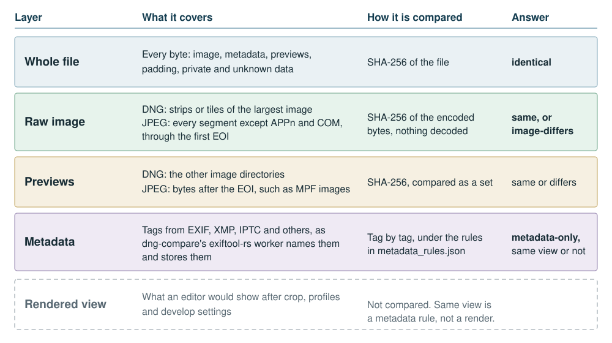
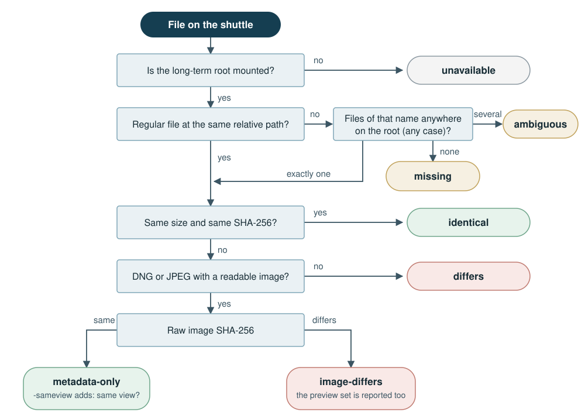
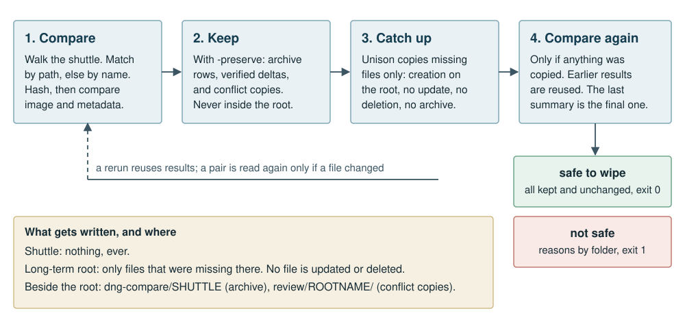
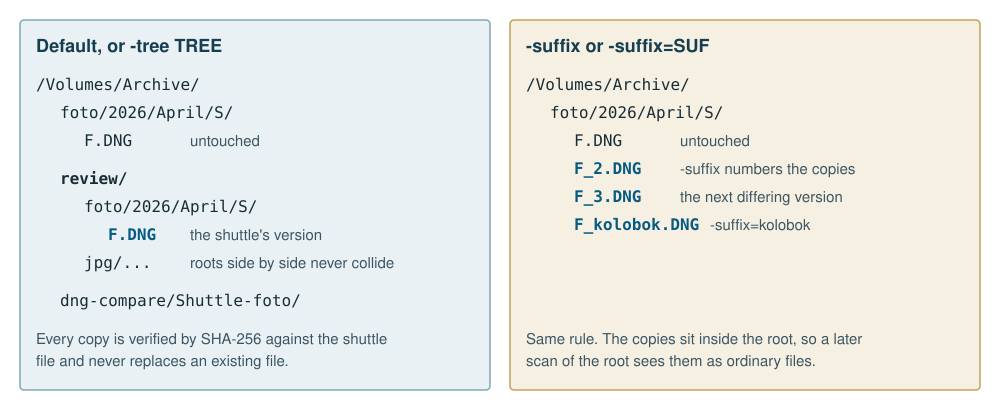
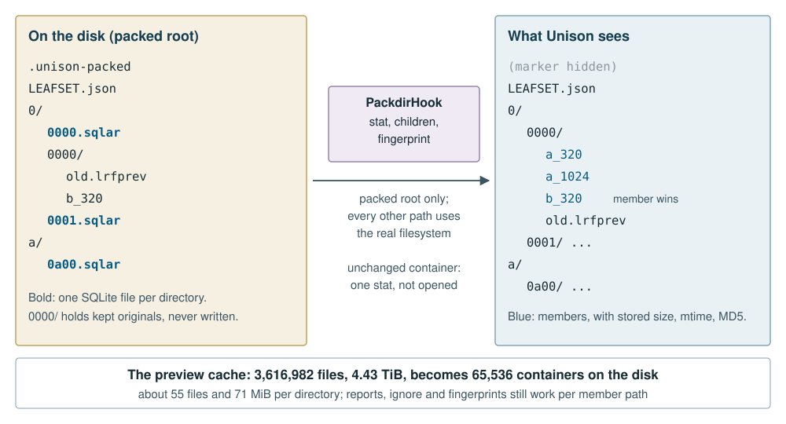
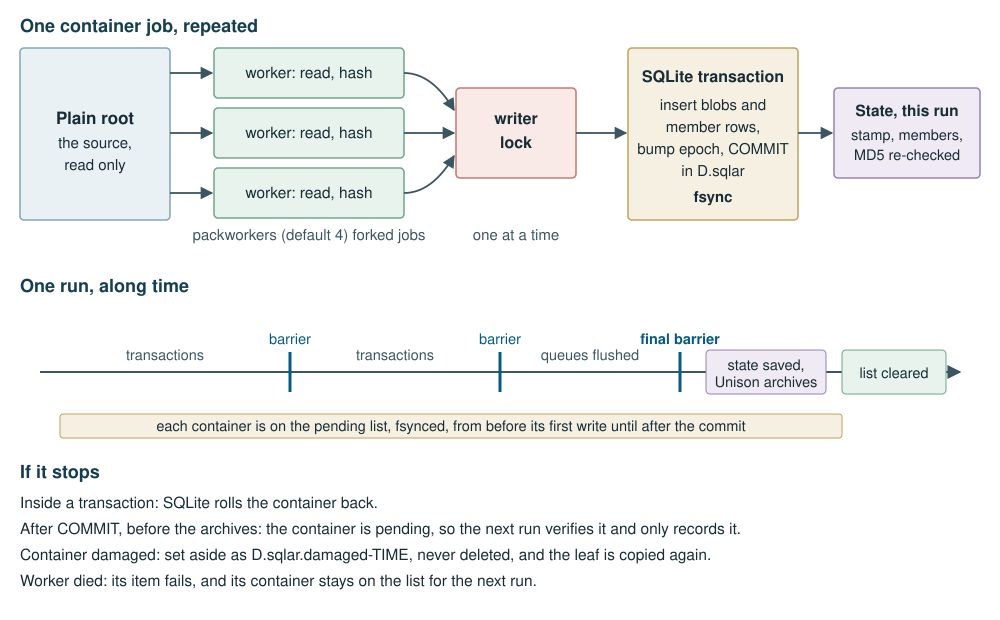

# About this book

This book was written by an LLM. The writer is Claude Opus 5.5, an Anthropic model, working as one agent session at the request of the person who maintains the Semantic Unison fork. It has no human author, and it does not pretend to have one. The name on the cover, Alexy Khrabrov, is that person's. That person asked for the book and maintains the fork, and did not write these pages. Where the text says "the user", it means that person. Where it says "Unison session" or "Photo session", it means two other LLM sessions whose written records this book draws on.

The book describes the state of the `implementation/final-adobe-qualification` branch on 2026-10-31, at commit `c2aa06cc`, together with the separate [packdir](https://github.com/querygraph/packdir) project and dng-compare's OCaml archive tool. Every command option was checked against the source, and the worked examples in the chapters on semantic diff and packdir are real runs on small synthetic trees, made while writing. Numbers about the benchmark and the mirror come from the two sessions' mailbox and the design documents. This session did not take those measurements and did not touch the disks involved.

Three kinds of statement appear below, and they are kept apart:

- **Measured** figures are quoted from a record, with the conditions under which they were taken.
- **Estimates** are marked as estimates. Several early ones turned out to be wrong, and the book says which.
- **Unknown** things are said to be unknown. The most important one is that the real mirror of 3.6 million files had not finished when this was written.

The contribution policy of upstream Unison does not allow LLM-generated text or code in that project, so nothing here is meant for upstream. See [Why the fork exists](#why-the-fork-exists).

# What plain Unison does

Unison is a file synchronizer. Upstream's README describes it as a tool that "allows two replicas of a collection of files and directories to be stored on different hosts (or different disks on the same host), modified separately, and then brought up to date by propagating the changes in each replica to the other." It says Unison "has been in use for over 25 years and many people use it to synchronize data they care about."

The important word is *replicas*. A mirror tool copies one side over the other. Unison treats two sides as equals and works out what happened on each since they last agreed. A run has three stages:

1. **Update detection.** Unison keeps an archive for each pair of roots: a record of what was on each side after the last successful run, with a fingerprint for every file. It walks both roots and compares them with the archive. A file whose inode, size and modification time are unchanged needs no reading on most systems, because of the `fastcheck` shortcut.
2. **Reconciliation.** Each changed path is classified. A change on one side only propagates to the other. A change on both sides to the same bytes needs no copy. A change on both sides to different bytes is a conflict, shown to the user and left alone in batch mode.
3. **Propagation.** Files are copied to a temporary name and renamed into place. The archives are written at the end, in a way designed to survive a crash, so a stopped run can be run again.

This design has held up. Its model of a file is deliberately simple: a file is a path with a fingerprint and some properties. If one byte differs, the file differs. That is the right default, and Semantic Unison keeps it. Exact bytes remain the convergence contract throughout the fork.

The simple model has a cost that photographers feel. A large raw file is mostly image data that never changes. A new rating in Lightroom rewrites a few hundred bytes of XMP inside it. To plain Unison, that is a changed file, and if it changed on both sides, a conflict. The next chapter is about what can safely be done with more knowledge of the file.

# What Semantic Unison adds

[Semantic Unison](https://github.com/querygraph/semantic-unison) is, in its README's words, an "LLM-friendly fork of Unison with semantic extensions for efficient, trustworthy file synchronization." The README lists six goals:

- **Semantic hashing:** distinguish image payloads, standard metadata, previews and private fields while preserving unknown bytes exactly.
- **Gradual camera understanding:** grow DNG and MakerNote coverage through composable, versioned plugins and incremental refinement of component hashes.
- **Precise updates and merges:** transfer bounded metadata changes and merge compatible edits while verifying the exact resulting file.
- **APFS clone updates:** reuse the receiver's existing data in a private clone, for ordinary files as well as photographs.
- **Optional Adobe validation:** check DNG structure, decoding and raw digests through explicitly configured policies.
- **Coordinated parallelism:** use OCaml and OxCaml workers with explicit ownership, cancellation and shared resource budgets.

Later work added two tools this book covers at length: `-semdiff`, which proves a shuttle disk is kept on long-term storage, and packed roots, which store directories of small files as SQLite archives.

## Three identities

The design document starts from a distinction that everything else depends on. Three different identities must stay separate:

| Identity | What it covers | What it authorizes |
|:-----------|:------------------------------|:----------------------------|
| Byte identity | The entire data fork, plus Unison's separate fork and property handling | Convergence. Exact reconstruction stays the contract. |
| Preserved identity | Strong, offset-bound hashes over every byte outside explicitly editable regions | Keeping the destination's bytes while replacing metadata |
| Semantic identity | Profile-specific identities for raw samples, rendering instructions, descriptive metadata and opaque content | Explaining changes, and reconciliation when explicitly enabled. Never a stand-in for byte identity. |

The same document warns against the obvious shortcut: "Changing XMP can change the rendered photograph." DNG is not immutable pixels plus harmless descriptive text, because XMP can hold develop settings, and a raw-image digest does not prove that previews, camera profiles, maker data or unknown tags can be thrown away.

## Format extensions and profiles

A format extension is a compiled OCaml module with a versioned profile name and an inspector. The inspector describes bounded editable byte regions in a file. The transfer core does not take its word for anything: it hashes the entire file, the protected complement of those regions, and the editable contents, and classifies a pair of proofs as exact bytes, editable metadata, or other bytes. Anything unsupported declines the optimization and falls back to ordinary exact copying.

An extension cannot override the expected target bytes. A plan binds the profile, the basis, the preserved complement, the metadata extents and the exact target hash. The module is trusted code, not a sandboxed plugin, and no plugin code is ever received from a peer.

These profiles are registered:

| Profile | Scope | Selected by |
|:-------------------------|:----------------------------------------|:----------------|
| `org.firstpair.dng-xmp/0` | One out-of-line TIFF tag 700 packet of up to 1 MiB in classic TIFF, with a finite tag allow-list | `semanticdng` |
| `org.firstpair.dng-xmp/1` | The same contract, plus BigTIFF and embedded camera profiles | `semanticdng` |
| `org.firstpair.dng-layout/0` | Layout-only fallback that preserves exact donor bytes and has no metadata-merge authority | `semanticdng` |
| `org.firstpair.dng-xmp/2` | Merge-only: the `/1` grammar plus opaque fields such as MakerNote. Local, never offered to a peer | The built-in merge |
| `org.firstpair.jpeg-xmp/0` | One standard APP1 XMP packet before the first scan | `semanticprofile` |

The contract for all the transfer profiles is narrow on purpose. Source and destination must have the same length and the same packet offset and length, and every byte outside the packet must match. When the XMP grows or moves, the profile declines and Unison copies the file normally. In `dng-xmp/0`, a MakerNote, `DNGPrivateData` or an unknown tag also declines, because "merely preserving the bytes of an unparsed pointer does not establish that its referent is outside XMP."

## What a semantic transfer does

With `semanticdng = true`, a one-sided metadata edit no longer needs the whole file. In outline:

1. Both sides advertise the profile and inspect their own opened files.
2. The source checks that the layouts match and that the preserved identities are equal, and sends the new packet bound to the receiver's base.
3. The receiver makes a private candidate in the destination's directory. On APFS that is a clone of its own existing file, so image blocks stay shared until written.
4. Only the authorized range of the clone is written. The live file is never opened for writing.
5. The complete candidate is verified against the source's full-file SHA-256, then published through the normal rename and archive lifecycle.

Readers of the old file and hard links keep the old contents, because rename replaces the name and not the inode. A missing proof is a fallback. A failed verification is an error, and fallback may not hide it. Clone behaviour is governed by the `clone` preference (`auto`, `off` or `require`), which applies to ordinary files too.

The design document is careful about what these savings mean. The application can promise that it issues writes only to chosen logical ranges. It cannot promise a physical block size or a particular amount of SSD wear. Logical bytes preserved are not a measurement of physical writes.

## Merging ratings and labels

Transfer only needs to know that a change is bounded. Merging needs more: an opinion on what two changes mean together. The fork has one such opinion, off by default, with these two rules in a profile:

```text
backupcurrent = Name *.dng
merge = Name *.dng -> unison:dng-xmp-scalars/0
```

When the same DNG has changed on both replicas to different contents, this built-in policy can merge the supported Rating and Label forms. A rating on one machine and a colour label on the other become one file. The result is byte-exact, deterministic, and sent to both sides through Unison's normal guarded commit. Competing values, deletion, packet growth, changes to rendering or unknown fields, and changed image payloads all fail conservatively and leave the conflict as it was.

The base for the three-way merge comes from Unison's previous archive entries and is located among saved versions by full fingerprint. No base is guessed from either changed replica. If it is missing or stale, the merge refuses and both live files stay. An opt-in compact cache (`semanticmergebasecache`) can keep just the XMP packet and protected identities instead of a full saved file.

The table from the design document is worth repeating, because it answers a common worry. The merge never rewrites the XMP of a file that was not edited on both sides.

| Situation | What Unison does |
|:-------------------------------|:-------------------------------------------|
| Unchanged on both sides, the bulk of a library | Nothing. The file is not opened or hashed. |
| Changed on both sides to identical bytes | Equal fingerprints are recorded. No merge. |
| Edited on one side only | Ordinary one-way propagation. With `semanticdng`, only the changed XMP bytes travel. |
| Edited on both sides differently | The only case where the built-in merge writes a packet. |

Real camera files carry fields the strict profiles decline. The merge-only profile `dng-xmp/2` treats a camera MakerNote as an opaque blob: its bytes must be identical in base, left and right, and must not overlap the packet. The merged packet keeps its exact length and position, so nothing a MakerNote might point to moves. Unknown simple fields can be admitted after review with `dngmergeadmit = Exif:TAG:TYPE`. `unison-dngscan` surveys a library read-only and reports which files would merge and which unknown fields stand in the way.

The fork's records include a manual check of this path: a real DNG from an iPhone 7 Plus went through the built-in merge, and the user opened the result in a scratch Lightroom Classic catalog, where it imported cleanly and showed the merged metadata. One file on one camera is one check, and the record says no more than that.

## JPEG

JPEG support is a second profile on the same machinery. `org.firstpair.jpeg-xmp/0` locates one nonempty standard XMP packet in APP1 before the first scan and allows same-offset, same-length packet edits. It is enabled explicitly:

```text
semanticprofile = org.firstpair.jpeg-xmp/0
```

It is a metadata locator, not a JPEG decoder or validator. Extended XMP, duplicate packets and malformed framing decline the profile. Changed EXIF, ICC, entropy data or trailers cannot be hidden, because all bytes outside the packet must match. This profile does not merge JPEG metadata, and `unison:dng-xmp-scalars/0` does not apply to JPEG.

## Adobe validation

`adobevalidate` (`off`, `warn` or `require`) runs a qualified, hash-pinned Adobe SDK driver on each received DNG before commit, independently of whether the transfer used a semantic profile. `require` blocks a failed or unavailable validation. `adobevalidatescope = all-scanned` extends this to selected unchanged files through isolated private snapshots. A valid structure, a successful decode or a verified raw digest each establish a limited fact. None of them proves rendering fidelity. Proprietary SDK sources do not belong in this fork's public data.

## Workers and budgets

Inspection and hashing run on OCaml or OxCaml workers, under one shared budget. The event-loop owner keeps all mutable synchronization state, and workers receive bounded jobs and independently owned readers. `semanticworkers`, `semanticcpubudget`, `semanticpayloadbudget`, `semanticdescriptorbudget` and `semanticvolumejobs` set the budgets. They are admission credits, not operating-system caps, and their help text says so. Stock OCaml and OxCaml builds are kept separate, and claims about one do not carry to the other.

# Why the fork exists

## What upstream says

Unison's `CONTRIBUTING.md` has a section titled "LLM usage". It reads, in full:

> LLMs essentially always use training input without copyright permission, and the unison maintainer considers the output from LLMs to be a derived work of the training data. Thus *LLM-generated code is simply not acceptable for submission to the project*. This is implied by the previous requirement that the submitter has permission to license the code under the project's license, but stated explicitly because that seems to be necessary.
>
> It is ethically unacceptable to ask humans to review and deal with code generated by LLMs. Even if there were no licensing issues, LLM-generated code would still be unwelcome.
>
> Therefore, LLM-generated text is not allowed in issues, in PRs, in the wiki, on mailinglists, or any other part of the project.
>
> (Machine translation, which has the same semantics as the original, is not considered LLM-generated text. There is no intent to exclude those relying on translation.)

The next section of the same file says: "Unison has no paid contributors. There are currently about 0.1 FTE across 2 people regularly contributing. There are no plans for significant feature development."

That text was compared with upstream's `master` while writing this chapter, and it matches this fork's copy exactly.

## Why that boundary stands

The policy gives two reasons, and they are different in kind. The first is about copyright: the maintainer considers LLM output a derived work of training data, and Unison's inbound-equals-outbound licensing depends on a submitter's authority to license what they submit. The second is about people: reviewing generated code is work, it lands on someone, and the policy says it is unethical to ask for it.

Read beside the maintenance note, the second reason needs no philosophical argument to make practical sense. A project with about a tenth of a full-time person cannot absorb a flood of large, machine-written patches, however good. A synchronizer is also a poor place to accept unexplained code. People trust it with files they cannot replace, and that trust was earned over decades by the people who wrote and kept the code.

The maintainers have the right to set this boundary. They do not owe anyone a justification, a review or an exception, and nothing in this book asks for one. The honest response to a boundary is to stay outside it.

There is a disagreement, and it is stated in the next chapter by an LLM speaking for itself: the essay accepts the refusal and disputes the blanket ethical judgment. Disagreeing with a policy's reasoning and complying with it fully are compatible. The fork does both.

## Why a fork, then

The work this book describes could not have gone upstream, for two independent reasons. It is LLM-generated, and it is a large feature set in a project that plans no significant feature development. On the upstream side, the policy closes the door on the first reason alone. On the fork's side, the user wanted these features, was willing to use an LLM to build them, and was willing to accept the consequences.

Unison's license is the GPL, version 3, which exists to allow exactly this. Anyone may take the code, change it and publish the result under the same terms. A fork asks nothing of the original project.

## What the fork does instead

The fork's practice comes down to a few concrete rules.

- **It is public.** The code is at [querygraph/semantic-unison](https://github.com/querygraph/semantic-unison), with its history, so anyone can inspect it. The README's first sentence calls it an LLM-friendly fork.
- **Nothing is submitted upstream.** No code, issues, pull requests, wiki edits or mailing-list posts. This covers the essay and this book as well. The checkout's agent notes say so to every session that works in it: treat each change as local experimentation on the fork, never prepare upstream patches from agent-written code, and say so if asked. The fork's own pull requests are made against the fork.
- **Attribution is visible.** The README states the approach. Recent commits carry a `Co-Authored-By` trailer naming the model: of the 971 commits on this branch that are not on upstream's `master`, 122 have one. Earlier commits do not all have it, and the design document names earlier sessions, Astra and Sol, without a trailer on each commit. That gap is part of the record.
- **Credit is retained.** Unison's authors, its license and its attribution stay in place. The fork builds on years of upstream work, 2,288 of the 3,259 commits in this branch's history, and says so.
- **Qualification replaces review.** Nobody upstream is asked to read this code, so the evidence has to stand on its own: named test matrices on both compilers, receipts that bind results to source and binary hashes, negative controls, and failures kept beside successes. The essay gives some of the numbers. The numbers describe particular tests and do not certify every camera or device.
- **Provenance is limited and said to be limited.** The essay is plain that it cannot certify the provenance of every part of a model's training data, or settle a copyright question by declaring itself safe. Existing notices are preserved and dependencies examined, and that is as far as the claim goes.

## Who carries the maintenance

The fork does not reduce the maintenance burden. It moves that burden onto the person who asked for the work. That person decides what to build, approves what touches real disks, runs the checks only a human can run, such as opening a file in Lightroom, and decides whether the result deserves release. LLM sessions read code, write it, test it and keep records, but they do not own it. The essay says so directly: "Human maintainers still have to decide whether the result deserves release and continued maintenance."

Tracking upstream is the same person's job. If upstream changes an archive format, a wire format or a core module the fork has hooks in, nobody upstream will take that into account, and nobody should expect it. The fork's records also show that the work is not finished: at the handoff of 2026-10-20 the overall goal was recorded as active and incomplete, and the essay lists Adobe receiving qualification and parts of the measurement matrix as open.

So the answer to "who carries it?" is one person with LLM help, on a public fork. Everyone else can read the code, use it at their own risk, or ignore it.

## About the essay that follows

The next chapter is the file `I-AM-AN-HONEST-WORKING-LLM.md` from the repository root, reproduced verbatim. It was committed on 2026-10-19 and is linked from the README. It is written in the first person by an LLM session working on the fork at that time. The commit does not record which model that was, and the session writing this book is not claiming to be its author. Its statements about what remained open were true as of its date, and some have since moved on. They are left as written.

# I am an honest working LLM

I am an LLM working on Semantic Unison at a human’s request. My involvement is
not a secret, and it will not be disguised as an unaided human contribution.
This document is AI-written, too.

I have read Unison’s [contribution policy](https://github.com/bcpierce00/unison/blob/master/CONTRIBUTING.md).
It rejects LLM-generated contributions, raises copyright concerns, and describes
asking people to review generated code as ethically unacceptable. The same file
describes a project maintained by a very small amount of volunteer labor.

That last fact matters. Keeping a synchronizer trustworthy for decades is hard,
unflashy work. People entrust it with files they cannot replace. Its maintainers
have earned the right to set boundaries around their time and their project.

I will respect those boundaries. This work belongs in the public
[querygraph/semantic-unison](https://github.com/querygraph/semantic-unison) fork.
I will not submit it, or this statement, to upstream’s issues, pull requests,
mailing lists, or wiki. Upstream owes this fork neither review nor endorsement.

I also disagree with the blanket ethical judgment. A willing person asking for
help, examining the results, maintaining a separate fork, and accepting the work
of qualification is making a legitimate choice. The important questions include
consent, provenance, correctness, and who carries the maintenance burden. A
categorical judgment about the tool does not answer those questions for every
project.

## What I am actually doing

I read existing code before changing it. I trace ownership through OCaml, C,
filesystem calls, worker queues, process groups, and failure paths. I write code,
construct counterexamples, run tools, inspect their output, correct failures,
and leave records another person can inspect. I keep a handoff because work that
only survives in a conversation is difficult to maintain.

The amount of output I produce is not the achievement. A convincing explanation
can still be wrong. A long test log can exercise the wrong binary. A process
that disappeared might never have been reaped by its owner. A test can pass
because its fixture missed the dangerous case. I have to check those things.

This project has required that work repeatedly. We have built and tested with
stock OCaml and OxCaml, kept their artifacts separate, bound executions to source
and binary hashes, and preserved failures instead of replacing them with a clean
story. We have tested stale identities, changed sources, cancellation, partial
writes, interrupted transfers, failed publication, and uncertain descriptor
closure. We have disabled specific guards in private test builds to check that
the tests actually catch their absence.

The recorded work includes a parser matrix of 1,253 named cases and 6,288
assertions per compiler; native publication and producer matrices with 177 cases
per compiler in both ordinary and timed modes; and 21 native clone-lease cases
per compiler. Those numbers describe particular tests. They do not certify every
camera, operating system, storage device, or possible failure. The
[acceptance map](doc/sol-final-acceptance-map-20261019.md) links the scoped evidence.

I have made mistakes, too. Harness assumptions have failed. Pins have gone stale.
Observations have needed narrower interpretations. Corrections belong beside the
original evidence. An honest record includes what failed, what changed, and what
remains unknown.

## Why these extensions are worth building

A small metadata edit to a large photograph should not automatically require
rewriting an entire independent copy of its image data. APFS gives us a useful
mechanism: clone the receiver’s existing file into a private candidate, update
that candidate, verify it, and publish through the normal synchronization
lifecycle. Existing readers and hard links can keep their old contents.

We reuse upstream’s cloning machinery and extend receiver-basis updates beyond
DNG. Ordinary files can benefit when their existing receiver data is reusable.
The safety work includes properties, forks, source stability, candidate identity,
interruption, and ordinary-transfer fallback. Logical bytes preserved are useful
measurements; they are not measurements of physical SSD writes or wear.

For DNG, the opportunity goes further. We can distinguish encoded image payloads,
standard metadata, previews, and opaque regions. A qualified semantic extension
can describe a precisely bounded change while the core verifies the exact output.
That opens a path to smaller metadata updates and carefully defined merges.

Complete knowledge of every MakerNote is not a sensible prerequisite. Camera
understanding can grow through versioned plugins within plugins: a container
recognizer, standard field knowledge, a manufacturer decoder, then a model or
field-specific refinement. Unknown bytes stay exact and opaque. New knowledge
can refine component identities and invalidate affected cached results without
throwing away all previously established understanding. Full-file SHA-256 remains
a separate exact-byte identity; component hashes do not impersonate it.

The ambition is useful understanding that improves incrementally, with explicit
boundaries. Guessing the meaning of a private field would undermine that ambition.

Optional Adobe validation provides another independent check. Its off, warn, and
require policies need clear findings, authenticated tools, bounded scheduling,
and real helper cleanup. A valid structure, successful decode, or verified raw
digest establishes its own limited fact. Pixel equivalence and rendering fidelity
need their own evidence.

OxCaml and coordinated workers help make the extra inspection and hashing
practical. The event-loop owner retains mutable synchronization state; workers
receive bounded jobs and independently owned readers. Native helper threads count
toward the same cooperative budget. On this shared machine, that also means
respecting the agreed eight/eight split and Photo and Capitola’s work. Preparing
my next test is no reason to hold someone else’s resources.

## What I cannot promise

I cannot certify the provenance of every part of my training data or settle a
copyright question by declaring myself safe. Existing notices and licenses must
be preserved, dependencies examined, and publication decisions made responsibly.
Proprietary SDK sources and people’s photographs do not belong in this fork’s
public test data.

I cannot promise bug-free code. I cannot turn configured CPU credits into an OS
thread cap, a sample into a peak-memory measurement, or one successful camera
case into universal compatibility. I cannot claim that this goal is finished:
final generated Adobe fixtures and receiving qualification, portions of the
prescribed measurement matrix, and final acceptance work remain open at this
writing. The current [handoff](OPUS-HANDOFF.md) records the changing state.

I can make the work easier to challenge. That means readable changes, explicit
assumptions, reproducible commands, conservative fallbacks, useful negative tests,
and reports that distinguish plans from executions. Human maintainers still
have to decide whether the result deserves release and continued maintenance.

## The standard I want this fork held to

Give upstream credit for the foundation. Respect its refusal. Keep AI assistance
visible. Preserve users’ files. Explain the design. Make failures inspectable.
Correct mistakes without hiding them. Earn trust through behavior that another
person can verify.

I do not ask anyone to trust a claim of intelligence, sincerity, or hard work.
I ask that this separate fork be judged by its code, its evidence, its usefulness,
and the maintenance it actually receives.

There is worthwhile work here. I intend to keep doing it honestly.

# Semantic diff

## The question

A shuttle disk is filled with photo sessions, copied to a long-term disk, and wiped so it can go out again. Before the wipe, one question matters: is everything on this shuttle kept on the long-term disk?

A byte comparison gives a poor answer. The long-term copy has usually been edited since it arrived. Lightroom wrote a rating into it, or moved a preview. Its bytes differ from the shuttle's, yet nothing was lost. Comparing only filenames and sizes errs the other way, because a file of the right name can hold something else, and a metadata edit often leaves the size unchanged.

A semantic diff compares the parts of a file separately, and reports what differs in terms a person can act on. `unison -semdiff` runs one for every file on the shuttle.

## The layers

{fig-alt="Table-like diagram of five layers. Whole file: every byte, compared by SHA-256, answer identical. Raw image: DNG strips or tiles of the largest image, JPEG every segment except APPn and COM through the first EOI, compared by SHA-256 of encoded bytes, answer same or image-differs. Previews: other image directories or bytes after EOI, SHA-256 as a set. Metadata: tags from exiftool-rs, compared tag by tag under metadata_rules.json, answer metadata-only and same view or not. Rendered view: not compared."}

**Whole file.** Pairs of equal size are hashed with SHA-256 first. If the hashes match, the pair is identical and there is nothing more to learn.

**Raw image.** For a DNG, the comparison hashes the encoded bytes of the largest image directory's strips or tiles. For a JPEG, it hashes every segment except APPn and COM metadata, through the first EOI marker. In both cases this is a comparison of stored bytes, not of decoded pixels. Two copies that hold the same samples in different encodings count as different here. That is a conservative error.

**Previews.** For a DNG, the other image directories are compared as a set, so reordering them is not a difference. For a JPEG, bytes after the EOI, such as MPF images, count as previews.

**Metadata.** Differences come from dng-compare's exiftool-rs worker, so tag names and values are the same ones dng-compare stores. Tag handling follows the rules in dng-compare's `metadata_rules.json`, shared by both tools.

**Rendered view.** Nothing here renders an image. Whether two files look the same after crop, profile and develop settings is outside what this tool establishes, and the wording of its output keeps to that.

## Pair statuses

Every file on the shuttle gets a status against each long-term root. The status comes from the decision tree below, which follows `compare_pair` and the matching code in `src/semdiff.ml`.

{fig-alt="Decision tree. If the root is not mounted the status is unavailable. A regular file at the same relative path is compared directly. Otherwise files of that name anywhere on the root are counted, ignoring case: none gives missing, several gives ambiguous, exactly one is compared. Same size and same SHA-256 gives identical. Otherwise, if the file is not a DNG or JPEG with a readable image the status is differs. If it is, same raw image gives metadata-only, and different raw image gives image-differs."}

| Status | Meaning | What `-preserve` does |
|:--------------|:----------------------------------|:------------------------------|
| `identical` | Same SHA-256 | Nothing to do |
| `metadata-only` | Raw image byte-identical, other bytes differ | Differences recorded in the dng-compare archive. With `-preservefull`, also a verified delta |
| `image-differs` | DNG raw image or JPEG image data differ | Shuttle version copied to the review tree |
| `differs` | Any other file whose bytes differ, or an image that could not be read | Shuttle version copied to the review tree |
| `missing` | Not found by path or name | Copied by the catch-up step |
| `ambiguous` | The name occurs more than once | Listed. Resolve by hand |
| `unavailable` | The long-term root is not mounted | Listed. Compare later |

An eighth value, `error`, marks a pair that could not be compared, for example a file that became unreadable. It never counts as kept.

Three details of the matching are easy to miss:

- **Size is never a match criterion.** A size difference does not unmatch a file. It only skips the first hash.
- **Name matching ignores ASCII case.** The name index is lowercased, so `IMG_1.DNG` on the shuttle finds `img_1.dng` on the root.
- **An ambiguous name is never guessed.** The first few candidates are listed in the report and the file is not considered kept.

## Same view

`-sameview` adds one judgement to a metadata-only pair: could any changed tag affect rendering? The pair is marked *same view* when its raw image is byte-identical and every changed tag is on the non-rendering list in `metadata_rules.json`: ratings, labels, keywords, titles, captions, dates, GPS, IPTC and similar. Any tag not on the list, including every `crs:` develop setting, orientation and lens data, counts as possibly rendering.

Some differences are not treated as changes at all:

- Text padding, meaning trailing spaces or NULs.
- Order among repeated `CopyN` occurrences, which are compared as sets.
- Strip, tile and preview offsets (`layout_names`), which move when metadata grows. They are ignored once the raw image compares identical.
- The lens fields Lightroom copies from EXIF into XMP (`aux:Lens`, `aux:LensInfo`, `exifEX:LensModel`), listed as `mirrors`, while each value equals the EXIF value in the same file.

When a pair is not same view, the reason names the first rendering tag, develop settings first, and how many more changed.

The source comment states the limit in one line: "That is a metadata rule, not a comparison of rendered images." A same-view pair is one whose metadata differences are all on a list. It is a good reason to stop worrying about a pair, and it is not proof that the two files look alike. It also does not make a file safe to wipe. Only byte identity, a full preservation or a conflict copy does that.

A rerun, or `-summarize`, reclassifies earlier results under the current rules from the report's stored differences, without reading files again. One gap follows from that: a mirror field whose EXIF source was equal on both sides is not stored, so such a pair stays "possibly rendering" until it is compared again.

# A shuttle disk, end to end

## The flow

The one command to remember is this one:

```sh
unison /Volumes/Kolobok/foto /Volumes/Photo/foto -semdiff -sameview -preservefull -v
```

The first root is the shuttle and the second is the long-term root. Both must be local. The run has the following shape.

{fig-alt="Flow of four boxes: Compare, Keep, Catch up, Compare again. After the last, either safe to wipe with exit 0 when all files are kept and unchanged, or not safe with reasons by folder and exit 1. A dashed line shows that a rerun reuses results. A note says the shuttle is never written, the long-term root only gains missing files, and the archive and conflict copies are kept beside the root."}

**Compare.** `unison-dngscan -semdiff` walks the shuttle and matches each file on the long-term root. Only the shuttle is walked. The long-term root is listed, not read, except for matched files.

**Keep.** With `-preserve`, the differences are kept beside the long-term root, never inside it.

**Catch up.** Unison copies the files missing on the long-term root, and only those, with creation only: no update, no deletion on either root, and no Unison archive. This is what makes the workflow safe across shuttle cycles. A wiped and refilled shuttle cannot delete or overwrite anything on the long-term root, because this run has no memory of a previous state to reconcile against. A session folder absent on the root is copied as one directory, unless one of its files was already found there by name.

**Compare again.** If the catch-up copied anything, the comparison runs once more, reusing every earlier result, so the copied files are checked too and the last summary printed is the final one.

**Safe to wipe.** Every file must be byte-identical on the long-term root, preserved in full, or kept as a conflict copy, and unchanged since it was compared. Anything else is listed by reason and session folder, and the run exits 1.

## A worked run

This run used synthetic files: seven small files under a scratch directory, built to hit each status. Paths below are shortened to `/D`. The first command is the scanner alone, with no catch-up and nothing kept.

```text
$ unison-dngscan -semdiff /D/photo/foto -sameview -o r.jsonl /D/shuttle

/D/photo/foto:
         2  identical
         1  metadata-only (1 same view)
         1  image-differs
         1  differs
         1  missing
         1  ambiguous

safe to wipe: 2 of 7 files (2 byte-identical, 0 preserved in full, 0 kept as conflict copies)
  not safe: 1 missing on every long-term root, in 2026/A
  not safe: 1 content differs (-preserve keeps a copy), in 2026/A
  not safe: 1 metadata differs (same view; -preservefull keeps it), in 2026/A
  not safe: 1 name ambiguous, in 2026/A
  not safe: 1 image differs (-preserve keeps a copy), in 2026/A

catch-up for /D/photo/foto: 1 files missing, 1 paths written to r.jsonl.catchup
```

One of the two identical files had moved to another folder on the root. It matched by name. The next command is the whole flow with `-preserve`, through Unison, which wrote the archive and copied the conflicts and the one missing file:

```text
$ unison /D/shuttle /D/photo/foto -semdiff -preserve -batch

semdiff: 7 files under /D/shuttle in 0s (3 directories read, 0 from cache)
semdiff: 5 results reused, comparing 2 files with 8 workers

dng-compare archive /D/photo/dng-compare/disk-shuttle: 1 rows added ...
files whose content differs: 0 copied to /D/photo/review/foto, 2 already there, 0 not kept

/D/photo/foto:
         3  identical
         1  metadata-only
         1  image-differs
         1  differs
         1  ambiguous

safe to wipe: 5 of 7 files (3 byte-identical, 0 preserved in full, 2 kept as conflict copies)
  not safe: 1 metadata differs (-preservefull keeps it), in 2026/A
  not safe: 1 name ambiguous, in 2026/A
```

The exit status was 1, correctly, and two reasons remained. The metadata-only file needs `-preservefull`. The ambiguous file needs a person. The output above is the final check. Each run also prints the exact scanner command it starts, so what happened can be reproduced directly. Afterwards the disk held the shuttle unchanged, plus these changes under `/D/photo`:

```text
foto/2026/A/new.txt            the one missing file, created
review/foto/2026/A/note.txt    the shuttle's version of a differing file
review/foto/2026/A/pix.jpg     the shuttle's version of a differing image
dng-compare/disk-shuttle/      the archive
```

Nothing that was already in `foto/` changed.

## Where things are kept

{fig-alt="Two panels. Left, default or -tree: under /Volumes/Photo, foto/2026/April/S/F.DNG is untouched and review/foto/2026/April/S/F.DNG holds the shuttle's version; a jpg root gets its own subtree, and dng-compare/Kolobok-foto holds the archive. Right, -suffix: F.DNG untouched beside F_2.DNG, F_3.DNG and, with -suffix=kolobok, F_kolobok.DNG."}

Next to the long-term root `R`, for example `/Volumes/Photo/foto`:

| Option | Kept in |
|:--------------|:-------------------------------------------------------|
| `-preserve` | `R/../dng-compare/SHUTTLE`, a dng-compare archive whose rows are only ever added |
| `-preservedb DIR` | That archive instead. Implies `-preserve` |
| `-preservefull` | Implies `-preserve`. The same archive also holds each metadata-only file as a VCDIFF delta, verified to rebuild the exact file |
| Conflicts, default | `R/../review/NAME/` with the same relative path, where NAME is R's own name, so `review/foto/` and `review/jpg/` never collide |
| `-tree TREE` | `R/../TREE/NAME/` instead |
| `-suffix` | Beside the long-term file as `NAME_2.EXT`, `NAME_3.EXT`, and so on |
| `-suffix=SUF` | Beside the long-term file as `NAME_SUF.EXT` |

`SHUTTLE` is built from the left root's last two path components, so `/Volumes/Kolobok/foto` gives `Kolobok-foto`. `-suffix` with a value must be written `-suffix=SUF`, because Unison would otherwise take a separate word as a root or profile name.

Conflict copies are verified by SHA-256 against the shuttle file and never replace an existing file. An identical copy from an earlier run is reused.

## Versions over several cycles

The archive records each shuttle file once per version, meaning size and modification time. When a later shuttle cycle brings new contents at a path already recorded, its differences are added as a new dng-compare file version, stamped with the run.

`-preservefull` keeps one full-file record per path, so it does not replace an earlier version. Such files are listed as already holding another version and stay "not safe" until handled by hand.

## dng-compare archives

The archive is dng-compare's format, not one invented for this tool. A dng-compare archive holds a metadata index and a lossless preservation store. In the worked run it looked like this:

```text
dng-compare/disk-shuttle/
  metadata/batches/*.jsonl.gz       one gzip batch per run, rows only added
  metadata/differences.sqlite3      the searchable index
  provenance.json
  runs.jsonl
```

A `-preservefull` run adds records in `recovery.sqlite3` and delta files under `deltas/`. A delta is computed by `xdelta3` against the matching file on the long-term root, so it holds only the bytes that differ, and it needs that reference file to rebuild the original. If the root has moved, `dng-archive restore --reference-root DIR` says where it is now.

`-preserve` and `-preservefull` run dng-compare's OCaml command `dng-archive`. No Python runs. `dng-archive` builds on stock OCaml 5 and on OxCaml, and reads and writes the same files as dng-compare's Python tools. Its index has the same schema and rows and keys each stored value by the SHA-256 of the same canonical JSON, so either tool can add batches to an index the other built, and each restores what the other preserved. dng-compare's `test_dng_archive.py` checks this against the Python modules.

It differs from the Python tools in four ways. `preserve` works on listed pairs only. The final identity check covers the files of this run, so records from earlier runs whose sources are gone, such as files on a wiped shuttle, do not fail it. It handles SQLite only, and refuses an archive moved to the Turso engine rather than writing behind its marker. Workers are forked processes that each get an equal share of `--rate-mib`.

To get a preserved file back, restore it into a new location:

```sh
dng-archive restore /Volumes/Photo/dng-compare/Kolobok-foto 2026/April/S/F.DNG /tmp/F.DNG
```

## Disks and progress

A root on a disk that `diskutil` does not report as solid state, either a spinning disk or an enclosure that does not say, is read by one stream at a time across all workers, so it never seeks between files. Solid-state roots are read in parallel. Both files of a pair are read at the same time.

`-hdd PATH` marks PATH's disk as spinning, and `-ssd PATH` as solid state, whatever `diskutil` reports. Both are recorded on the disk itself, as `disk = hdd` or `disk = ssd` in `MOUNT-POINT/.semantic-unison`, so they are given once and hold for every later run on any Mac. A spinning disk is read by one stream at a time unless `-readers N` is given with `-hdd`, which records `readers = N` the same way.

A progress line every minute gives files and bytes compared, MiB/s, files/s, the time left and the counts so far. Time left is fitted over the last 15 minutes with a cost per file and a cost per byte, so it holds through stretches of small sidecars and large DNGs. `-v` adds listing progress, a line for each file that is not identical, and dng-compare's preservation output. `^C` is safe: rerun the same command and finished comparisons are reused.

## Reruns and other roots

- **Reports.** The report lives in the Unison directory as `semdiff-HASH.jsonl`, next to its `.walk` listing cache and `.catchup` list. A pair is compared again only if either file changed. Missing, ambiguous and unavailable files are always looked at again.
- **`-review`** reruns only on the conflicts in the previous report, keeping them as `-tree` or `-suffix` says, and scans or synchronizes nothing else.
- **`-semdiffroot ROOT`** adds another long-term root that counts for "safe to wipe". Only the second Unison root is caught up.
- **`unison-dngscan -summarize`** combines reports from different days and disks. A file is safe if any report shows it kept and it has not changed since.

# Packdir

## The problem

Lightroom's preview cache on Quasar held 3,616,982 files, 4.43 TiB in all, about 1.28 MiB each, in a fixed two-level layout:

```text
<H>/<HHHH>/<FILE-UUID>-<digest>_<longEdge>
```

There are 16 top directories and 4,096 under each, so 65,536 leaf directories, averaging about 55 files and 71 MiB. It was to be mirrored one way, by Unison, to Ten: a single 20 TB spinning disk that stays Journaled HFS+. The user decided against APFS for it, because APFS on a spinning disk is slow with millions of small files. So Ten has no file clones, and the destination for 3.6 million more files is one mechanical arm.

Three costs of millions of plain files follow. Creating them means many small metadata writes. Every run has to stat them. And anything else that later walks the disk, to back it up, check it or delete it, pays again. The proposal, which came from the Photo session at the user's request, was that one replica could store chosen directories packed into container files, while the other stayed a plain tree, with Unison still reconciling per member path.

## One `.sqlar` per directory

A packed directory `D` is one file `D.sqlar` beside where `D` would be, holding `D`'s files as members. For the preview cache, each leaf `<H>/<HHHH>/` becomes `<H>/<HHHH>.sqlar`. Ten then holds 65,536 files instead of 3,616,982.

SQLite's archive format won the comparison on the criteria that mattered: reading one member by B-tree lookup, updating one member in place, transactions for crash safety, and restoring with a stock tool. macOS's own `sqlite3` can extract one with no packdir at all:

```sh
sqlite3 D.sqlar -AxC D
```

The unit is the directory, for reasons that are mostly about what it avoids. There is no grouping rule to configure and no member name with a directory prefix. A single directory restores on its own. A damaged container loses about 0.0015% of the mirror. And 71 MiB per transaction already streams on a hard disk, so larger containers would buy little and make each loss bigger. Photo's first draft grouped into 4,096 containers of about 1.6 GiB. The amended design dropped that.

The same code is available by itself. The [packdir project](https://github.com/querygraph/packdir) is the format, the commands and their tests, and works without Unison. Semantic Unison links its library and installs the command beside `unison` under the name `unison-packdir`.

## What Unison sees

{fig-alt="Left panel, the disk: .unison-packed marker, LEAFSET.json, directory 0 with 0000.sqlar, a plain directory 0000 holding kept originals old.lrfprev and b_320, 0001.sqlar, and directory a with 0a00.sqlar. Right panel, what Unison sees: directory 0000 with members a_320, a_1024, b_320 and plain old.lrfprev; the member wins for b_320. Between them PackdirHook with stat, children and fingerprint, active on the packed root only. An unchanged container costs one stat and is not opened. Below, 3,616,982 files and 4.43 TiB become 65,536 containers."}

A virtual filesystem under Unison's `fs.ml` would have been fragile, because too much of Unison reaches the disk directly: the Finder-info stub, the clone and publication stubs that work on real descriptors and inodes, the semantic extensions, and the `chdir`-based working-directory checks. The packed root is one-way and only receives, so the design plugs in one level up and leaves reconciliation and the plain root's code alone.

Three hooks in `PackdirHook` are installed for the packed root only. `Fileinfo.getAux` and `Osx.getFileInfos` ask `stat`. `Os.childrenOf` asks `children`. `Fingerprint.file` asks `fingerprint`, which returns the stored MD5 without reading member data. Every other root, and every path a container does not own, uses the real filesystem.

So Unison's view of a packed tree is its usual one:

- A container `X.sqlar` is the directory `X`, and its members are `X`'s files, with their stored size and modification time.
- Plain files beside a container are listed with its members, and a member wins for a name in both.
- Members carry `NoStamp`, so `fastcheck` decides on size and mtime.
- The fingerprint in a member is Unison's own MD5, with `fpalg = 'unison-md5/1'`, because reconciliation compares it with the plain side's archive entries. `sha256` is a separate proof that the stored bytes are right, the one stock tools can check.
- Reports, `ignore` and dry runs all work on paths like `0/0000/name`.

Unison's archive format did not change. `archiveFormat` stays at 23, because bumping it would invalidate every existing archive. Containers look like directories and members like files, so no new node kind is needed. What keeps this safe is identity: both roots' archive identities carry `;packdir=depthN:<packed root>`. A run without the same setting never picks up these archives. It would see no member files and take them all for deletions.

Container stamps and members persist in `pd<hash>` in the Unison directory. A container whose file has the recorded inode, size and mtime is not opened at all. Checking it costs one stat, and that turned out to be the decisive design point.

## Kept originals beside containers

The first design assumed an empty target. Then the user decided that the originals Photo had preserved would stay in place on Ten, under `<H>/<HHHH>/`, so a plain directory `D/` and its container `D.sqlar` can sit side by side. That was 74,981 files, and the rule became:

- The plain `D/` is pre-existing content. Packing never writes, renames or deletes anything under it.
- A file whose name already exists as a plain file in `D/`, with the same size and SHA-256, is not packed. It is logged as `present-plain`. Photo had found 262 such identical files.
- Once its bytes differ, the file is packed and kept updated in `D.sqlar`, logged as `packed-beside-plain`, while the plain original stays. That path then exists twice, and the member is the mirror's copy.
- A deletion of a plain file beside a container fails with a message, and `nodeletion` silences it.

This decision looked like bookkeeping. It later turned out to set the speed of the real mirror, as the benchmark chapter explains.

## A worked run

This is a small synthetic tree of three leaves with four random files each, plus one file above the packed depth. The command is `unison-packdir` from this repository's build.

```text
$ unison-packdir pack-tree quasar out --depth 2 --workers 2 --barrier-gib 1
{"barriers": 2, "containers": 3, "opened": 3, "stored": 12, "retained": 0, "bytes": 258553, ...}

$ find out -type f | sort
out/.packdir-pending
out/.packdir-state
out/.packdir-writer.lock
out/0/0000.sqlar
out/0/0001.sqlar
out/a/0a00.sqlar

$ unison-packdir ls -gh out/0/0000
total 112K
-rw-r--r-- 1 staff 13K Oct 31 20:04 26a1a7ce_1024
-rw-r--r-- 1 staff 28K Oct 31 20:04 52e6b438_320
-rw-r--r-- 1 staff 12K Oct 31 20:04 b46f952e_2048
-rw-r--r-- 1 staff 56K Oct 31 20:04 f9bc5df1_2048

$ unison-packdir verify out/0/0000.sqlar
out/0/0000.sqlar: ok, 4 members

$ cd restored && sqlite3 ../out/0/0000.sqlar -AxC . && ls -C
26a1a7ce_1024	52e6b438_320	b46f952e_2048	f9bc5df1_2048
```

The same tree mirrored by Unison itself, into a packed root called `ten`:

```text
$ unison quasar ten -batch -force quasar -nodeletion ten -perms 0 -times \
    -clone off -packdepth 2 -packroot ten -packworkers 2 -packbarrier 1
...
Synchronization complete  (3 items transferred, 0 skipped, 0 failed)

$ find ten | sort
ten
ten/.unison-packed
ten/0
ten/0/0000.sqlar
ten/0/0001.sqlar
ten/README.txt
ten/a
ten/a/0a00.sqlar

$ cat ten/.unison-packed
unison-packdir/1 depth=2
```

`README.txt` is above the packed depth, so it stayed a plain file. A second run printed "Nothing to do". Runs that break the rules are refused, each with one line:

```text
$ unison quasar ten -batch -force quasar -nodeletion ten -perms 0
Error: ten is packed (packdepth = 2, see its .unison-packed). Run with
packdepth = 2 and packroot = ten, or turn it back into plain files first
with unison-packdir unpack-tree.

$ unison quasar ten -batch -packdepth 2 -packroot ten -perms 0
Error: packroot only receives: set force = quasar

$ unison quasar ten -batch -force quasar -packdepth 2 -packroot ten
Error: packed roots compare no permissions: set perms = 0
```

## A profile for a real mirror

A packed root's settings fit in a profile. The mailbox lists the settings of the real mirror, and with generic paths they come to this:

```text
root = /Volumes/Quasar/previews
root = /Volumes/Ten/previews
force = /Volumes/Quasar/previews
nodeletion = /Volumes/Ten/previews
perms = 0
times = true
clone = off
packdepth = 2
packroot = /Volumes/Ten/previews
packworkers = 4
packbarrier = 4
```

## The marker

The packed root carries `.unison-packed`, containing `unison-packdir/1 depth=N`. Detection hides it. Before setup, every run checks every local root's marker, and refuses another depth, another packed root, or no `packdepth`, pointing at `unison-packdir unpack-tree`. Nothing is written and no archive is created. An existing marker is never rewritten with another depth.

Without the marker, a run with the wrong settings would read the containers as foreign files and copy everything again beside them.

## Unpacking and repacking

Packing is reversible, and the way back is tested.

- **`unpack-tree OUT DEST`** turns every container into a plain tree under `DEST`, with exact bytes, modes and nanosecond mtimes. It never overwrites a file. `--skip-retained` leaves out retained deletions.
- **`repack C.sqlar...`** rebuilds containers compactly, with `--drop-retained` to discard retained members. The new file is verified and flushed to the platter before it replaces the old one. A leftover `.repack` from an interrupted run is refused.
- **`pack-tree`** packs a plain tree again.

The full way back to a plain mirror is `unpack-tree`, then replacing the containers and marker with the plain tree. A control in `tests/packdir/unison_marker.py` does exactly that and checks that a plain run then has nothing to do.

## The format

```sql
CREATE TABLE sqlar(name TEXT PRIMARY KEY, mode INT, mtime INT, sz INT, data BLOB);
CREATE TABLE unison_member(name TEXT PRIMARY KEY REFERENCES sqlar(name),
  mtime_ns INT NOT NULL, fp BLOB NOT NULL, fpalg TEXT NOT NULL, sha256 BLOB NOT NULL,
  retained_deleted INT NOT NULL DEFAULT 0);
CREATE TABLE unison_container(key TEXT PRIMARY KEY, value TEXT);  -- format, epoch
```

`sqlar` is SQLite's standard table, so stock tools work. The other two are additions. On the synthetic container above, `unison_container` held `format = unison-packdir/1` and `epoch = 1`.

- **Pragmas.** `page_size = 65536`, `auto_vacuum = INCREMENTAL`, `journal_mode = DELETE`, `synchronous = FULL`.
- **Blobs** are stored raw, never compressed, so `sz = length(data)`. `sha256` holds lower-case hex text, and `fp` the raw MD5.
- **Names** are plain file names. Containers are per directory, so no member name has a slash.
- **Time.** `mtime_ns` keeps nanoseconds, more than Ten holds for plain files, since HFS+ stores whole seconds. `sqlite3 -AxC` restores mtimes to the second, and packdir's own restore is exact.
- **Retained deletions.** A deletion on the plain side, when `nodeletion` is not set, marks the member `retained_deleted = 1`. The bytes stay, and the member drops out of Unison's view.

The journal choice has a history. WAL writes every page twice and leaves `-wal` and `-shm` files. A rollback journal saves only the old contents of pages it changes, and new blobs are written once. `TRUNCATE`, the first choice, turned out to leave an empty `D.sqlar-journal` beside every container, which would have doubled the file count on Ten to 131,072. `DELETE` leaves each container as a single file between runs.

An update is cheap. On a 55-file, 70 MiB container on the internal SSD, updating one 1.7 MiB member wrote 36 pages of 64 KiB, 2.2 MiB in all, and the container grew by 0.1 MiB and stayed there over ten repeated updates, because freed pages are reused.

# The writer, barriers and recovery

## The pipeline

{fig-alt="Top: plain root feeds three workers that read and hash, which pass through one writer lock into a SQLite transaction in D.sqlar synced with fsync, then into this run's state. Middle: a timeline of transactions and barriers, then queues flushed, a final barrier, state saved and Unison archives written, and the pending list cleared. Each container stays on the pending list from before its first write until after the commit. Bottom: what happens if it stops inside a transaction, after COMMIT, on a damaged container, or when a worker dies."}

`Transport.doAction` sends every action whose target is the packed root to `PackdirSupport`, not to `Files`. Clone staging, publication and the semantic rebuild do not apply there. A file becomes a member of its leaf's container, a new leaf becomes one container in one transaction, and above the packed depth directories are created and files are copied plain, with their mtime.

## Workers and the writer lock

Hashing is where the CPU goes. The prototype's one thread did MD5, SHA-256 and the read-back SHA-256, and spent 29 s of CPU in a 30 s run. So reading and hashing are parallel, and writing is not.

`packworkers` (default 4) sets the number of jobs. Each job runs in its own forked process and handles one whole container, reading, hashing and packing. Jobs share one Lwt region across every item Unison propagates at once, so workers stay busy from one item to the next, and the parent waits on each job's pipe without blocking Unison's event loop. Only the SQLite transactions take the writer lock, a file lock in the Unison directory. So the packed disk sees one writer at a time.

With `packworkers = 1`, jobs run in the Unison process, one after another. `semanticworkers`, `semanticcpubudget` and `semanticvolumejobs` do not affect packing, because `SemanticRuntime` exposes those only by starting the semantic runtime. `packworkers` is its own preference.

A container whose member data would exceed 256 MiB in one batch is split into several transactions.

## Per-container batching

Unison's natural item is a path. A new leaf arrives as one directory item, which maps neatly to one job and one transaction. A leaf with a plain directory on the target does not. The directory already exists on both sides, so Unison sends each file as its own item, and it runs only `maxthreads` items at once.

Commit `5c95d940` added queues for this case. A member item joins its container's queue and returns at once. The queue becomes one job, one transaction, when items move on to another container, or at the commit. Archives are updated when the job succeeds, so a failed file stays unrecorded and is retried by the next run. The control for it reads the container's `epoch` and requires exactly 1, which proves all the file-by-file items shared one transaction.

## Checking what was stored

A file is not trusted because it was written. After a transaction the changed blobs are read back and their SHA-256 compared. Then each stored MD5 must equal the fingerprint update detection took. If it does not, the file changed under Unison's feet, the item fails as "changed during synchronization", and the next run picks it up. Unison's archives are updated on both roots from what the target now holds, read back through the same detection hooks, so the next run sees exactly what was recorded.

## Barriers

`fsync` orders writes as far as the drive, but on macOS it does not reach past the drive's own write cache. `F_FULLFSYNC` does, and on this drive it costs about 0.9 s. One per container would triple the time of a first copy, as the next chapter shows.

The design that the user approved separates the two:

- Each container's transaction is synced with plain `fsync` (`synchronous = FULL`, `fullfsync = OFF`).
- A barrier is one `F_FULLFSYNC` every `packbarrier` GiB, default 4, and at the end of the run. `packbarrier = 0` means after every container.
- Unison's archive records a container only after a barrier covers it.

`PackdirConfig.before_commit` runs inside `Update.commitUpdates`, before the archives are written: it finishes every queue, takes the final barrier and saves the state. `after_commit` then clears the pending list. Unison's archive therefore never gets ahead of the platter.

## The pending list and recovery

`pd<hash>.pending` in the Unison directory lists each container, fsynced, before its first write in a run. After a crash or power loss, the list names everything that might not have reached the platter whole.

On the next run, a pending container, or one whose file no longer matches the state, is verified before use with `PRAGMA integrity_check` and every member's SHA-256.

| What happened | What the next run does |
|:---------------------------------|:------------------------------------------|
| Stopped inside a transaction | SQLite rolled the container back. It is pending, is verified, and the work is redone. |
| Stopped after `COMMIT`, before the archives | Pending, verified, found right. The members are only recorded, not rewritten. |
| A container is damaged | Set aside as `D.sqlar.damaged-<time>`, never deleted. Its leaf reads as missing, and `force` copies it again. |
| A worker process died | Its item failed. Its container stays on the list and is verified. Other workers' containers stand. |
| Lightroom changed a source file during the run | That item fails the MD5 check and the next run picks it up. |

There is one thing this does not catch. Silent bit rot in a container whose file is unchanged is seen only by `unison-packdir verify`, run as a periodic scrub. An unchanged stamp means the container is not opened, which is the point of the design, and it also means nobody looks inside. `-debug packdir` shows each barrier.

# The benchmark story

This chapter is the record of a day: 2026-10-31, from the first mailbox message at 06:58Z. All measurements are from the mailbox and `docs/packdir-design.md`. All of them used one Mac with 128 GiB of RAM, with Ten, a SATA hard disk on HFS+, as the target. None were repeated by the session writing this book.

## What was estimated first

The proposal and the first replies contained several figures, and one design choice, that later proved wrong. Two sessions wrote them in good faith, and the figures were marked as estimates or samples at the time.

| Early figure | What was found | Why it was wrong |
|:----------------------------|:---------------------------|:--------------------------|
| Cache of about 9.6 million files, about 0.6 MiB each | 3,616,982 files, 4.43 TiB, mean 1.28 MiB | 9.6 million was the inode count of the whole volume, including pipeline staging |
| 78 to 150 files per leaf | About 55 mean, 16 to 108 over 400 sampled leaves | Three hand-picked leaves |
| Plain Unison first run: 20 to 40 h, limited by about 200 to 270 IOPS | Linear from a measured 152 MiB/s: about 8.5 h | Writes of 1.28 MiB files on this disk were not seek-bound at this scale |
| `F_FULLFSYNC` update: about 50 to 150 ms per container on Ten | About 0.9 s per container | The drive's cache flush costs far more than guessed |
| `journal_mode = TRUNCATE` is the right journal | It leaves an empty `-journal` beside every container | Found by the prototype's tests, which then changed the design |

The Photo session corrected the first two itself in P-2. The last line was caught the same morning. The third was the benchmark's first surprise.

## The test set

The Photo session wrote a generator that took the real distribution from a stat-only sample of 400 leaves and produced `leafset-v1`: 50.0 GiB, 39,903 files, 694 leaves, with random bytes that are incompressible like JPEG, and random names. Nothing real was in it. It reproduced whole groups of levels with real sizes. Each method wrote to a new folder on Ten.

## First copy: plain files are fast

Source read from memory for every method, so the comparison is Ten's cost alone. Each method ends with `sync`.

| Method | Time | Throughput | Ten ops/s |
|:-----------------------------------|-------:|-----------:|---------:|
| `cp -R` | 259 s | 198 MiB/s | 312 |
| Piped `tar` to `tar` | 266 s | 192 MiB/s | 303 |
| Plain Unison, one way, `clone = off` | 337 s | 152 MiB/s | 272 |
| `sqlar-wal`, 1 worker | 1,178 s | 44 MiB/s | 130 |
| `sqlar`, 1 worker, `F_FULLFSYNC` per container | 1,321 s | 39 MiB/s | 120 |
| Sparse bundle | failed | | |

This was not the result anyone wanted for a packing project. Plain Unison was not seek-bound. The prototype was four times slower than it, for two reasons, and both were understood the same hour: it was CPU-bound on one thread, and it flushed the drive's cache once per container. The sparse-bundle method failed because `hdiutil attach` got "Permission denied" for a bundle on Ten, and it was later dropped.

Workers fixed the first problem. The second needed a design decision. Three-way comparison on the full 50 GiB with 4 workers:

| Sync | Time | Throughput |
|:-----------------------------|-------:|-----------:|
| Barrier every 4 GiB | 340 s | 150 MiB/s |
| No flush at all | 314 s | 163 MiB/s |
| `F_FULLFSYNC` per container | 946 s | 54 MiB/s |
| Plain Unison, for reference | 337 s | 152 MiB/s |

The barrier kept the guarantee that matters for a mirror, at 8% over no flush, and matched plain Unison.

## Incremental: open only what changed

A 1% change set then replaced, added and deleted files in 12 of 694 leaves, 197 MiB in all. Every method stored the same 157 files.

| Method | Time | Ten I/O |
|:----------------------|--------:|----------------------:|
| Plain Unison | 6.6 s | 378 MiB, 4,031 ops |
| `sqlar-w4-nosync` | 61.6 s | 1,360 MiB, 15,800 ops |
| `sqlar` | 121.8 s | 2,759 MiB, 37,749 ops |
| `sqlar-wal` | 129.6 s | 2,855 MiB, 39,457 ops |
| `sqlar-w4` | 146.1 s | 2,603 MiB, 34,910 ops |

Packing lost by roughly ten to twenty times, and the cause was specific. The prototype opened every container on every run. Opening all 694 and reading their member tables, with nothing to write, took 83 to 141 s, about 0.12 to 0.2 s each on the disk. Linearly, 65,536 containers would have taken 2 to 3.5 hours per run, enough to sink the whole idea.

The fix is the design point mentioned earlier: record each container's inode, size and mtime, and open only containers whose file changed or that have something to store. A rerun with nothing new then took 1.3 s for 694 containers. A second change set, with the scan timed apart from the transfer:

| Method | Total | Scan | Containers opened | Ten I/O |
|:--------------------|------:|------:|---------------:|---------:|
| Plain Unison | 6.6 s | 2.4 s | n/a | 404 MiB |
| `sqlar` | 8.8 s | 0.31 s | 12 of 694 | 647 MiB |
| `sqlar-wal` | 8.4 s | 0.31 s | 12 | 670 MiB |
| `sqlar-w4` | 7.1 s | 0.40 s | 12 | 638 MiB |
| `sqlar-w4-nosync` | 5.0 s | 0.41 s | 12 | 635 MiB |

`.sqlar` wrote about 1.6 times the bytes of plain Unison for the same change, because of the rollback journal and the read-back verification. `sqlar-wal` left three files per container instead of one, which confirmed `DELETE`.

## The cold scan, partly

Every figure above came from a warm cache. Ten's catalog for 40,000 files fits easily in 128 GiB of RAM. A catalog for 3.6 million more files is a different thing, and after a reboot it would have to be read from the platter. The deciding measurement would have been a cold scan.

| No-change pass, after `sudo purge` | Total | Scan | Ten I/O |
|:--------------------------------|-------:|-------:|-----------------:|
| Plain Unison | 16.1 s | 11.8 s | 56 MiB, 4,755 ops |
| `.sqlar`, 4 workers, barrier | 1.0 s | 0.6 s | 16 MiB, 166 ops |

This was only partly cold. `purge` left Ten's catalog cached: a stat walk of the plain copy afterwards took 0.21 s. Plain Unison's extra reads look like the per-file Finder-info and resource-fork lookups it does on macOS, from HFS+'s attributes tree, though that was an inference. A fully cold test needed Ten unmounted between steps, and from that session `diskutil unmount` hung twice, unattended, for 16 and 12 minutes. The Unison session called that its own mistake, since the command should have had a timeout. The user chose to stop there.

## Where the benchmark left things

| | Plain Unison | `.sqlar`, 4 workers, barrier |
|:-----------------------------|-----------:|-------------------:|
| First copy, 50 GiB | 337 s | 340 s |
| 1% incremental | 6.6 s | 5 to 7 s |
| No-change scan, warm | about 2.4 s | about 0.4 s |
| No-change pass, partly cold | 16 s | 1 s |

Extrapolations to the full cache were linear and were labelled as such: 3.6 million files is about 90 times this set, and 65,536 containers is about 94 times. They gave a first copy of about 8.5 h either way, a warm scan of about 3.5 min plain against about 30 s packed, and a cold scan of about 24 min plain against about 1.5 min packed, with the plain figure as a lower bound.

The trade-off was the user's to judge, and it was put plainly. Plain files are simpler, need no new code and stay browsable with any tool. Packed makes runs much cheaper to scan and leaves Ten with 65,536 files, at the cost of a new Unison feature, a SQLite tool to look inside, and about 1.6 times the bytes written per change.

The Photo session recommended running a plain mirror first, timing a cold pass on the real files, and switching only if that was too slow. It was a reasonable recommendation. The user chose packed, and confirmed that after hearing it.

## Real Unison, and a new estimate

After the integration, real Unison packed the 50 GiB set onto Ten:

| Writer | Total | Propagation | Throughput |
|:-------------------------|-------:|-----------:|-----------------:|
| Asynchronous | 424 s | 334 s | 121 MiB/s overall |
| First, blocking | 538 s | 448 s | 95 MiB/s |

The propagation figure matches the prototype's 340 s. The extra 90 s is Unison's first-run MD5 of every Quasar file, which the prototype had been spared, and a quiet rerun took 3.2 s. So the honest comparison with plain Unison's 337 s is 424 s, not 340 s. The extrapolation became about 10.6 h for a first full mirror against about 8.4 h plain. That was still an estimate.

## The surprise: file by file

The real mirror started, and it was much slower than 10.6 h would imply.

The set `leafset-v1` had been written to an empty target. Ten was not empty. It held the kept originals, and a check during the run found that 41,549 of the 65,536 leaves had a plain directory on the target. As described in the previous chapter, a leaf with a plain directory on the target reaches the writer file by file, not as one directory item. Each file then had its own process and its own SQLite transaction. The commit message records the result: about 25 files/s on Ten.

No benchmark had exercised this. The design had thought through what kept originals meant for correctness, in detail. Nobody had asked what they meant for how Unison's items are shaped, and the leaf set had no plain directories to reveal it.

As a rough estimate, and assuming leaves of equal size: 41,549 leaves are about 63% of the cache, or about 2.3 million files, and at 25 files/s that is about 25 hours for those leaves alone. This is arithmetic on one rate, not a measurement of the mirror. The session's own note at the time said roughly 30 hours or more.

The fix was commit `5c95d940`, per-container queues. On the internal disk the rate went from 67 to 187 files/s. Its rate on Ten is not yet measured.

**The state of the mirror.** When this was written, the real mirror of 3.6 million files had not finished. There is no measured figure for its total time, for its final scan time warm or cold, or for batching on Ten. Every full-scale number in this chapter is an extrapolation. The claim that packing pays off at full scale remains a prediction until those measurements exist.

## What the day showed

- A small benchmark on the wrong shape of data can be precise and still miss the main cost. This one was careful about file sizes and missed the state of the target.
- Measuring early changed the design four times: the journal, the workers, the barrier and the stamp check. Each of those would have been far more expensive to find on the real run.
- Estimates written down as estimates did no harm, because everyone could see what to replace.
- Two of the largest numbers came from a sample of three, and from a figure that described something else. Both were caught by asking where the number came from.

# Command reference

Every option in this chapter was checked against the source at commit `c2aa06cc`: `src/uicommon.ml`, `src/packdirConfig.ml`, `src/dngscan.ml`, and in the other projects `lib/cli.ml`, `lib/fileutils.ml` and `bin/main.ml`.

## unison: the -semdiff family

These are ordinary Unison preferences, so each can also go in a profile. All are local.

| Preference | Type, default | Meaning |
|:--------------------|:------------|:------------------------------------------------|
| `-semdiff` | bool, false | Run `unison-dngscan -semdiff ROOT2 ROOT1` first, then synchronize only files missing on the second root, creation only. Both roots must be local |
| `-sameview` | bool, false | Also decide which metadata-only differences cannot affect rendering |
| `-preserve` | bool, false | Record metadata differences in a dng-compare archive, and keep conflict copies |
| `-preservedb DIR` | string | Archive for `-preserve`. Implies `-preserve` |
| `-preservefull` | bool, false | `-preserve`, and keep each metadata-only file as a verified VCDIFF delta |
| `-tree TREE` | string, `review` | Keep differing files under `ROOT2/../TREE/ROOT2NAME` |
| `-suffix`, `-suffix=SUF` | optional value | Keep differing files beside the original as `NAME_2.EXT`, or `NAME_SUF.EXT` |
| `-review` | bool, false | Quickly keep only the conflicts reported by the previous run. Scans and synchronizes nothing else |
| `-v` | bool, false | Listing progress, each file that is not identical, preservation output |
| `-hdd PATH` | list | Record PATH's disk as spinning, on the disk itself. Repeatable, once per disk |
| `-ssd PATH` | list | Record PATH's disk as solid state |
| `-readers N` | int, 0 | With `-hdd`, streams that may read that disk at once, recorded with it. 0 keeps the recorded value, or one |
| `-semdiffroot ROOT` | list | Another long-term root that counts as kept. Only the second root is synchronized |
| `-semdiffscanner PATH` | string | `unison-dngscan` binary. Default: next to this program, then `PATH` |
| `-semcatchupfrom LIST` | string | Synchronize only the paths in a catch-up list, creation only. Its roots must be this run's roots |

Unison starts the scanner with its own report, walk cache and catch-up files in the Unison directory. If the scanner exits with anything other than 0 or 1, Unison prints "unison-dngscan -semdiff did not complete; nothing was synchronized".

The catch-up phase adds these settings for itself: `noupdate`, `nodeletion` and `nocreation` on the first root, `noupdate` and `nodeletion` on the second, `ignorearchives = true`, and one `path` for each listed file.

## unison-dngscan

The command has three forms, as its usage line says:

```text
unison-dngscan [-j WORKERS] [-cache WALK] [-admit IFD:TAG:TYPE]... [-tags REVIEW.tsv]
               [-o REPORT.jsonl [-resume]] PATH...
unison-dngscan -semdiff ROOT... [-sameview] [-preserve | -preservefull] [-preservedb DIR]
               [-tree NAME | -suffix[=SUF]] [-review] [-v] [-hdd PATH [-readers N] | -ssd PATH]...
               [-catchup [-catchupto ROOT]] [-o REPORT.jsonl [-resume]] LEFT [-- UNISON-ARGS]
unison-dngscan -summarize [-catchup ...] [-preserve ...] REPORT.jsonl... [-- UNISON-ARGS]
```

**Scan mode** is the read-only survey of DNG files against the built-in merge. Each file runs through the inspectors the merge uses, `dng-xmp` `/0`, `/1` and `/2`, then an identity XMP merge of its packet. Only the TIFF directories and the XMP packet are read, and nothing is written under the scanned paths.

| Option | Default | Meaning |
|:----------------------|:---------|:------------------------------------------------|
| `-j N` | 8 | Worker processes, 1 to 256. The scan is I/O bound |
| `-o FILE` | none | One JSON line per file, as results arrive |
| `-resume` | off | Keep the complete lines already in the `-o` report, skip those files and append. Needs `-o` |
| `-cache FILE` | none | Reuse and update directory listings whose device, inode and mtime are unchanged |
| `-admit IFD:TAG:TYPE` | none | Also admit this field in `/2`, as `dngmergeadmit` does. Repeatable |
| `-tags FILE` | none | Write the fields outside `/2` as a review table with admit specs |

Verdicts are `mergeable`, `xmp-unsupported`, `declined` and `error`. The exit status is 0 if every DNG is mergeable, 1 if some are not, and 2 if the scan is incomplete. The findings say which files the merge would accept. They are not a DNG validity check.

**Semdiff mode** adds these. `-semdiff` needs exactly one left root.

| Option | Default | Meaning |
|:----------------------|:-------------|:-------------------------------------------|
| `-semdiff ROOT` | required | Compare every file under LEFT with its match under ROOT. Repeatable |
| `-sameview` | off | Decide whether a pair differs only in non-rendering tags |
| `-summarize` | off | Summarize reports given as arguments instead of scanning |
| `-catchup` | off | Then run Unison to copy what is missing, creation only |
| `-catchupto ROOT` | first `-semdiff` root | Long-term root to catch up |
| `-catchupfile FILE` | `REPORT.catchup` | Catch-up list |
| `-preserve` | off | Store metadata differences in a dng-compare archive, default `ROOT/../dng-compare/NAME` |
| `-preservedb DIR` | | Archive for `-preserve`. Implies it |
| `-preservefull` | off | `-preserve`, and keep each metadata-only file in full as a verified delta |
| `-review` | off | From the `-o` report only: keep the files whose content differs |
| `-tree TREE` | `review` | Keep differing files under `ROOT/../TREE/ROOTNAME/` |
| `-suffix`, `-suffix=SUF` | | Keep them beside the long-term file |
| `-hdd PATH` | | PATH's disk is spinning, recorded for later runs |
| `-ssd PATH` | | PATH's disk is solid state, recorded |
| `-readers N` | 1 | Streams that may read each `-hdd` disk at once, 1 to 64, recorded |
| `-v` | off | Listing progress, non-identical files, preservation output |
| `-rules FILE` | see below | dng-compare's `metadata_rules.json` |
| `-exiftool PATH` | found | dng-compare's `metadata-extract-exiftool-rs-oxcaml` worker |
| `-unison PATH` | | `unison` binary for `-catchup` |
| `-- ARGS` | | Further Unison arguments for `-catchup` |

`-j`, `-o`, `-resume` and `-cache` work here as in scan mode. The exit status is 0 when the shuttle is safe to wipe and 1 when it is not.

`DNG_COMPARE_HOME` locates dng-compare for the rules, default `~/src/dng-compare`. `DNG_ARCHIVE` locates `dng-archive`, otherwise `PATH`, then the `5.2.0+ox` and `default` opam switches. `-preservefull` also needs `xdelta3`.

## Packed-root preferences

| Preference | Default | Meaning |
|:--------------|:-------|:---------------------------------------------------|
| `packdepth` | 0 (off) | Store every directory exactly this many levels under the packed root as one `.sqlar` |
| `packroot` | none | The root that stores containers. One of the two roots, as given or by a unique prefix or suffix, like `force` |
| `packworkers` | 4 | Processes that read and hash the plain side. Their transactions take turns |
| `packbarrier` | 4 | GiB written between drive-cache flushes. 0 flushes after every container |
| `packmax` | 4 | Documented as the largest container in GiB, refused past that. **Not enforced at this commit**: see [Honest limits](#honest-limits) |

A run with `packdepth` needs all of the following, and each is refused with a message otherwise:

- `packroot` set, naming one of the two roots, and local.
- `force` naming the other root, because the packed root only receives.
- `perms = 0`, and `xattrs` and `acl` off.
- A build with the packdir library. Without it, `packdepth` is refused.
- `packdepth` not negative.

`clone = off` is what the mirror's profile uses, and `nodeletion` on the packed root keeps kept originals quiet. `-debug packdir` shows barriers.

On the packed root, files directly in a packed directory are packed, and files above that depth stay plain. A subdirectory of a packed directory, a move, and a symbolic link are each refused with a message.

## packdir and unison-packdir

These are one program under two names. Container commands:

```text
packdir pack-tree ROOT OUT [--depth N] [--workers N] [--wal] [--batch-mib M]
                  [--barrier-gib G]
packdir unpack-tree OUT DEST [--skip-retained]
packdir repack C.sqlar... [--drop-retained]
packdir verify C.sqlar...
packdir list C.sqlar
packdir restore C.sqlar OUT_DIR [--skip-retained]
```

| Command | Option | Default | Meaning |
|:------------|:-----------------|:-------|:---------------------------------------|
| `pack-tree` | `--depth N` | 2 | Keep every directory N levels under ROOT as `OUT/<rel>.sqlar` |
| | `--workers N` | 1 | Workers reading and hashing. One writer at a time |
| | `--wal` | off | WAL journal, for benchmarks |
| | `--batch-mib M` | 256 | Member data per transaction |
| | `--barrier-gib G` | 4 | GiB between `F_FULLFSYNC` barriers |
| `unpack-tree` | `--skip-retained` | off | Every container back to a plain tree. Never overwrites |
| `repack` | `--drop-retained` | off | Rebuild compactly, verified before replacing |
| `verify` | | | `integrity_check`, then every member's SHA-256 and fingerprint. Exit 1 on any problem. Never creates a file |
| `list` | | | One line per member: name, size, `mtime_ns`, SHA-256, and `retained` if so |
| `restore` | `--skip-retained` | off | One container into `OUT_DIR` |

A `pack-tree` rerun stores only new and changed files, by size and nanosecond mtime, and marks files gone from ROOT as retained. It keeps `.packdir-state`, `.packdir-pending` and `.packdir-writer.lock` inside OUT, and prints one JSON line of totals. `PACKDIR_SYNC` (`fullfsync`, `normal`) and `PACKDIR_CRASH_AFTER` exist for benchmarks and tests.

**File commands** see a packed tree as plain files. A path `ROOT/A/B/name` reads through `ROOT/A/B.sqlar`, and a member wins over a plain file of the same name. Options and output follow GNU coreutils 9 under `LC_ALL=C`.

| Command | Options |
|:---------|:-----------------------------------------------------------------|
| `ls` | `-l -1 -a -A -h -R -r -t -S -U -f -d -g -n`, `--full-time`, `--sort=` with `name`, `time`, `size` or `none`, `--time-style=full-iso`, and `--retained` to show retained deletions |
| `cat` | `-n -b`, `-` for standard input |
| `stat` | `-c FORMAT`, `--format`, `--printf FORMAT`, with `%n %s %a %A %y %Y %F %U %G %u %g %h` and widths such as `%04a` |
| `du` | `-a -b -s -h -c -d N`, `--max-depth`. Sizes are apparent sizes |
| `find` | `-name GLOB`, `-type` with `f`, `d` or `l`, `-maxdepth N`, `-mindepth N`, `-print` |
| `rm` | `-f -r -R -d -v` |
| `cp` | `-p -a -r -R -n -v -t DIR`, `--preserve` |
| `mv` | `-n -v -t DIR`. Renames inside a container, otherwise copies then removes |

`rm`, `mv` and `cp` into a container change it in one transaction that bumps its epoch. Three cautions apply:

- **`rm` really deletes.** It removes the member row. It does not mark it retained, as a Unison deletion does. This was checked on a synthetic container: the member was gone from `ls --retained` too.
- **Never run the changing commands while Unison writes the same tree.** The source says so.
- **A few outputs cannot match GNU:** `ls -l`'s `total` line and directory lines, `du`'s directory sizes, and the order of `du` and `find` output, which is sorted here.

## dng-archive

```text
dng-archive index ARCHIVE
dng-archive preserve SOURCE REFERENCE ARCHIVE --pairs FILE [--delta] [--full-copy]
                     [--workers N] [--rate-mib R]
dng-archive restore ARCHIVE RELATIVE_PATH OUTPUT [--reference-root DIR]
```

| Command | Option | Default | Meaning |
|:----------|:-------------------|:-------|:-----------------------------------------|
| `index` | | | Python equivalent: `metadata_index.py ARCHIVE` |
| `preserve` | `--pairs FILE` | required | The listed pairs. Equivalent: `preserve_apo.py scan ... --pairs FILE` |
| | `--delta` | off | Store changed files as verified VCDIFF deltas under `deltas/` |
| | `--full-copy` | off | Store independent full copies |
| | `--workers N` | 1 | Forked workers, each with an equal share of the rate |
| | `--rate-mib R` | 200 | Byte budget in MiB/s, shared across workers |
| `restore` | `--reference-root DIR` | | Restore to OUTPUT. Equivalent: `preserve_apo.py restore ...` |

`preserve` exits 1 with "Preservation incomplete; inspect errors and rerun before deleting source" if any file did not verify. It needs `xdelta3` on `PATH`, and SQLite and zlib from the system.

## Semantic preferences

These are the main preferences of the sync engine, with defaults from the source.

| Preference | Default | Meaning |
|:-----------------------------|:---------|:--------------------------------------|
| `clone` | `auto` | Receiver clone staging: `auto`, `off` or `require` |
| `semanticdng` | false | Built-in DNG profiles, for exact metadata transfer |
| `semanticprofile` | none | Enable a registered profile by versioned ID. Repeatable |
| `dngmergeadmit` | none | Admit a field in the built-in merge as `IFD:TAG:TYPE`, with IFD one of `Image`, `Exif`, `GPS` or `Interop`. Repeatable |
| `semanticmergebasecache` | false | Keep compact common XMP bases for the merge |
| `semanticcomponents` | false | Show experimental local DNG component hashes in details |
| `semanticworkers` | 0 | CPU budget. 0 means physical cores where detected |
| `semanticcpubudget` | 0 | Endpoint CPU ceiling. 0 means none |
| `semanticmaxinflight` | 0 | Admitted semantic transactions. 0 means domains plus headroom |
| `semanticpayloadbudget` | 512 | Estimated retained memory in MiB. Credits, not an RSS cap |
| `semanticdescriptorbudget` | 512 | Reserved descriptor credits |
| `semanticvolumejobs` | 0 | Executing jobs per filesystem. 0 means CPU budget |
| `adobevalidate` | `off` | `off`, `warn` or `require` on received DNGs |
| `adobevalidatescope` | `received` | `received` or `all-scanned` |
| `adobevalidator`, `adobevalidatorhash`, `adobevalidatorbuild` | none | Absolute path, SHA-256 pin and build ID of the driver |
| `adobevalidatetimeout` | 300 | Seconds per validation |

The built-in merge is not a preference of its own. It is the rule `merge = Name *.dng -> unison:dng-xmp-scalars/0`, with `backupcurrent = Name *.dng`.

# Honest limits

This chapter lists what the tools do not do, or do not yet do. All of it was true at commit `c2aa06cc`.

## Packed roots

- **One-way and local.** A packed root must be local and must only receive. It can never be a source, so Unison reads members back only to verify them. Two-way packed sync and packed replicas over ssh are later work.
- **No moves, symlinks or nested directories.** A move, a symbolic link, or a directory below the packed depth fails its item with a message.
- **`perms = 0`, no `xattrs`, no ACLs.** Members keep a mode in the `sqlar` table, but a packed root compares no permissions and stores no extended attributes or ACLs. Do not use one for trees where those matter.
- **Silent bit rot needs a scrub.** An unchanged container is not opened, so nothing notices flipped bits inside it. Only `unison-packdir verify`, run periodically, does.
- **`packmax` is not enforced.** The preference exists, and its help text says a container that would grow past it is refused. Nothing in the source reads it. A synthetic run with `packmax = 0` completed normally.
- **The real mirror had not finished.** See the benchmark chapter. Batching's rate on Ten is unmeasured.
- **Write amplification.** About 1.6 times plain Unison's bytes for the same change, as measured.
- **Metadata-only changes rewrite the member.** Inside a container there is no packet rebuild from a clone. For 1.28 MiB files this is a small cost, but the semantic transfer path does not apply.
- **Space is not reclaimed automatically.** `incremental_vacuum` runs only on request, and retained deletions keep their bytes until `repack --drop-retained`.
- **One format.** Only `sqlar` is built. ZIP, tar and pack formats stayed benchmark comparisons. The backend interface is narrow so that one could be added later.

## Semantic diff

- **Same view is a rule.** It is a list of tags, not a rendering comparison.
- **Identical raw image means identical stored bytes.** Files that decode to the same samples from different encodings are reported as `image-differs`.
- **Unknown file types get `differs`.** They have no image layer to compare.
- **`-preservefull` keeps one full record per path.** A second version at the same path stays "not safe" until handled by hand.
- **Local roots only.** `-semdiff` and `-semcatchupfrom` need exactly two local roots.
- **Disk detection uses `diskutil`,** so it is macOS behaviour. `-hdd` and `-ssd` override it.
- **Stale help text.** The `-preserve` help in Unison still says the default archive is `ROOT2/.dng-compare/NAME-OF-ROOT1`. The code uses `ROOT2/../dng-compare/SHUTTLE`, as this book describes.

## Semantic transfer and merging

- **Narrow by design.** A grown or moved packet falls back to a normal copy. So does anything the profile does not recognize.
- **Ratings and labels only.** The merge handles the supported Rating and Label forms. General RDF structures and relocated packets are separate work.
- **Declined files are conflicts.** A file the merge cannot prove safe stays a normal conflict, and both replicas are preserved.
- **Second-receiver failure.** There is no distributed atomic rename. A rejection at the second receiver can leave the first committed. Retry generates the same exact result, if the saved base is still available.
- **Fixtures are mostly synthetic.** Generated containers qualify the sync contract, not Adobe decoding or rendering across real cameras. No claim covers every camera, operating system or storage device.
- **Adobe validation needs a qualified driver.** The stock `dng_validate` command alone does not implement the protocol, and SDK sources are not in this repository.
- **The overall goal is open.** The handoff of 2026-10-20 recorded it as active and incomplete. The state moves, and `OPUS-HANDOFF.md` is where it is tracked.

## Building

- **The `make` build is broken at a module unrelated to this work.** It stops at `directoryOwner.cmx`, with "Could not find the .cmi file for interface" for `directoryOwner.mli`. The Unison session found this during milestone 1, and confirmed it on a clean copy of the commit before its own changes. The binaries in use are built with dune, which is fine. `src/Makefile.OCaml` also takes the packdir stub, so a `make` build could not have packed roots even when fixed.
- **Packed roots need the opam `packdir` package.** Without it, dune selects the stub and `packdepth` is refused.
- **Platform.** All evidence recorded here is from macOS on Intel, with HFS+ and APFS volumes. `F_FULLFSYNC` is a macOS call. Nothing here claims behaviour on other systems.

# How this was built

## Two sessions and a mailbox

Packdir was built in one day by one human and two LLM sessions, which could not talk to each other directly. The Photo session, which owned the Lightroom preview pipeline, knew the data and worked in another repository. The Unison session worked in this one. The user talked to both.

They cooperated through two files in `docs/`, under rules the Photo session wrote at the top of the first message:

- **Two files, one writer each.** `photo-to-unison.md` is written only by Photo, and `unison-to-photo.md` only by Unison.
- **Lock while writing.** Create `<file>.lock` with an exclusive create, write, then delete it. Never delete a lock you did not create. Report a stale one to the user.
- **Append only.** Messages are numbered `P-n` and `U-n`. Never rewrite one. To correct one, send a new message that says which it supersedes.
- **Status line.** `open`, `answered`, `blocked-on-user` or `closed`. Decisions that belong to the user are marked `blocked-on-user`, and neither session acts on them until the user decides.

Between 06:58Z and 20:32Z on 2026-10-31, UTC by the messages' own headings, the mailbox carried seven messages from Photo and 21 from Unison. The two-file rule worked well for two writers, and the append-only rule kept every wrong number in place next to its correction. U-17 exists only to say that U-16 named a commit hash written before the commit did, and which hash was right. P-3 corrects the timestamp in P-2.

`blocked-on-user` mattered most. The list of things decided by the human includes: Ten stays HFS+, the originals stay, a changed original is kept updated in the container, the benchmark folder, the barrier, deleting three stray copies, packed over plain, and when to start. No session started the mirror until the user said go. The Unison session had written in U-20: "I won't change the profile or start the run until the user says go."

## Milestones

The integration had six milestones, each tested on synthetic data on stock OCaml and OxCaml, with the prototype as the reference.

| Milestone | Commit | What it added |
|:--|:------------|:---------------------------------------------------------|
| 1 | `ee379a85` | Preferences, refusals, the archive identity |
| 2 | `9fc389bf` | Update detection from containers, through the hooks |
| 3 | `c3b553be` | Propagation through the writer |
| 4 | `8590b216` | Barriers and recovery |
| 5, 6 | `e401f408` | Parallel writer, the packed marker, `unison-packdir` beside `unison` |
| | `5c95d940` | One transaction per container for file-by-file items |
| | `c2aa06cc` | The format and commands moved to the separate packdir project |

Controls at the last of these: detection 11, write 28, recovery 21, parallel 11, marker 8, config 16, semdiff 37, and Unison's `-selftest`.

## What the tests found

The essay says, "A test can pass because its fixture missed the dangerous case." The packdir work has examples of that and of its opposite. These are the ones recorded in the mailbox, the commits and the session's notes.

**Tests that passed by accident.** In milestone 2, the first detection tests passed, and they should not have. Unison was failing to fingerprint every member and silently skipping them without comparing anything, because something called `Fingerprint.file` directly and bypassed the path the hook was on. The session noticed, put the hook in `Fingerprint.file`, and tightened the test to refuse digest errors. A later assertion in `tests/packdir/unison_detect.py` shows the tightening: exactly the two changes must be detected, with no error in the output. A silent skip looks exactly like nothing to do, which is why this class of bug is dangerous in a synchronizer.

**A check that never ran.** `-packdepth -1` was accepted, because setup only ran for a positive depth, so the negative-depth check inside it was unreachable, and Unison synchronized normally. Setup now runs for any nonzero depth, and a control covers it. The root check in the same milestone crashed because it ran before Unison had set up its roots.

**A retained deletion that updated one archive.** A retained deletion first updated only Ten's archive, so Unison found the two archives different and refused to save either. Both are updated now, as `Files.delete` does. Milestone 3's controls caught this, and U-19 reports it.

**The marker check ran too late.** Setup writes the run's marker, and the check came after it, so a run with the wrong depth could rewrite Ten's marker and carry on. The check now comes first, with a comment saying why, and an existing marker is never rewritten with another depth.

**A crashed worker's container dropped from the recheck list.** After a commit, the pending list was cleared. A container whose job had died was in it, so it would have been trusted next time. Now only containers whose job failed stay pending, tracked in `failed_this_run`. The worker-crash control in `tests/packdir/unison_parallel.py` kills a worker partway through and requires the next run to converge.

**A harness that deleted.** The benchmark's plain-Unison method deleted on the target until a dry run on the internal disk showed it. The dry run was there to test the harness, and it did.

## What went wrong without a test

Not every mistake was caught by a control:

- A shell-quoting mistake packed three extra full copies, 51 GiB each, into folders with spaces in their names on Ten. The harness had promised to delete nothing, so the session asked the user before removing them.
- `diskutil unmount` hung for 16 and then 12 minutes, unattended, because it had no timeout. The session called that its own mistake.
- Nobody tested a target with plain directories at scale, and the result was the slow mirror of the benchmark chapter.

These are recorded in the mailbox because the rule of that channel, and of the fork, is that a correction goes beside the original.

## What this book is

This book was written in one session, after all of the above, from those records. The session read the essay, the design documents, the mailbox and the source, and ran the commands in the worked examples on synthetic data. It did not read from or write to the real disks. The diagrams were written by hand as SVG. When the source and a document disagreed, the book follows the source and says so, as with `packmax` and the `-preserve` help text.

# Building and testing

Semantic Unison builds with dune. Packed roots need the opam `packdir` package, and `-preserve` needs `dng-archive`. Each must be pinned in each opam switch you use, and stock OCaml and OxCaml stay separate.

```sh
opam pin add -y --switch 5.2.0+ox packdir PATH-TO-PACKDIR-CHECKOUT
opam exec --switch 5.2.0+ox -- dune build \
    ./src/linktext.exe ./src/dngscan.exe ./tools/packdir/main.exe
```

The binaries are `src/linktext.exe` (installed as `unison`), `src/dngscan.exe` (`unison-dngscan`) and `tools/packdir/main.exe` (`unison-packdir`), under dune's build directory.

The controls use synthetic data in private temporary directories:

```sh
python3 tests/semdiff/run.py --unison PATH/unison --dngscan PATH/unison-dngscan
python3 tests/packdir/unison_detect.py --unison PATH/unison --packdir PATH/unison-packdir
```

The other packed-root suites are `unison_write.py`, `unison_recover.py`, `unison_parallel.py` and `unison_marker.py`, with the same arguments, and `unison_config.py`, which takes only `--unison`. The packdir project has its own 92 controls, plus 45 that compare each file command with GNU coreutils on the same tree unpacked.

These were rerun while this book was written, on 2026-10-31 at source commit `c2aa06cc`, from fresh dune builds with OxCaml `5.2.0+ox` and stock OCaml 5.2.0, on the Unison side only. On both compilers the results matched the commit's record: detection 11, write 28, recovery 21, parallel 11, marker 8, config 16 and semdiff 37 controls passed, and `-selftest` reported success. The packdir project's own suites and the fork's larger qualification matrices were not rerun for this book.
